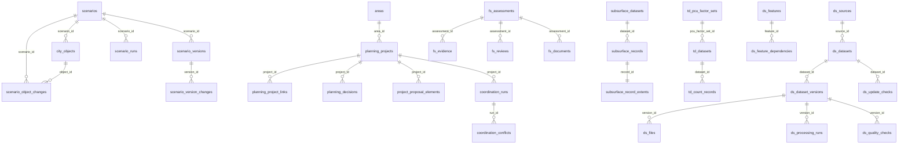

# UrbanOS — Database and code guide

_Audited against the code at git `8c923ac` (branch `urbanos-city-planning-redesign`) and a read-only copy of `backend/twincity.db` (opened with `?mode=ro`), 2026-11-14 (IST). Row counts are that snapshot; they change as the app is used._

> **Updated 2026-11-22 (IST) against `main` at `ba7a003`.** The endpoint list (§2) was regenerated from the code, the table list (§3) was re-checked against a freshly created database (44 tables), and the files added since 2026-11-14 are in §1.9. The practical, task-oriented companion is [DEVELOPER_HANDBOOK.md](DEVELOPER_HANDBOOK.md).

Related docs: [START_HERE](START_HERE.md) · [PROJECT_OVERVIEW](PROJECT_OVERVIEW.md) · [DATA_CATALOGUE](DATA_CATALOGUE.md) · [CURRENT_STATUS_AND_ROADMAP](CURRENT_STATUS_AND_ROADMAP.md) · [LEARNING_GUIDE](LEARNING_GUIDE.md)

How to read this guide: §1 is a file map (what each important file does, which functions to look at, which feature it serves). §2 lists every HTTP endpoint. §3 explains the database. §4 is configuration. §5 tests. §6 is a list of things that are stubbed, unused or inconsistent. Paths are relative to the repository root.

---

## 1. File map

### 1.1 Entry points and app shell

| Exact file path | Purpose | Important functions/classes | Connected features |
|---|---|---|---|
| `backend/main.py` | Creates the FastAPI app, creates/migrates tables, installs audit triggers, runs seeds, mounts 17 routers under `/api`, CORS `*`, gzip for responses ≥ 1 KB, `x-actor` middleware | `app`, `_actor_header`, `read_root` (`GET /`) | everything |
| `backend/database/connection.py` | SQLAlchemy engine/session from `DATABASE_URL` (default `sqlite:///./twincity.db`) | `engine`, `SessionLocal`, `Base`, `get_db` | all routers |
| `backend/database/migrations.py` | Additive `ALTER TABLE … ADD COLUMN` for `scenarios` (kind, baseline_id, parent_scenario_id, created_at) and `planning_projects.preferred_scenario_id` | `migrate` | scenarios, projects |
| `backend/seed.py` | Ensures the mandatory `base` scenario; CLI seed used by CI | `ensure_base_scenario`, `create_schema`, `seed_scenarios`, `main` | scenarios |
| `backend/repair_road_sections.py` | One-off CLI to repair road `sections` properties in `city_objects` | `repair_database`, `restore_database`, `normalize_sections` | Design (road data) |
| `frontend/src/main.tsx` | React root with `ErrorBoundary` | — | all |
| `frontend/src/App.tsx` | Renders `AppShell` with the `ModelTrustPill` (traffic model fails TAG M3.1) | `App` | all |
| `frontend/src/shell/AppShell.tsx` | Layout: top bar, rail, context panel, map, inspector, drawer; Ctrl/⌘K palette, Alt+1…7 | `AppShell`, `CONTEXTS`, `DRAWER_TABS` | all 7 workspaces |
| `frontend/src/shell/workspaces.ts` | The 7 workspace definitions and engine-mode mapping | `WORKSPACES`, `modeForWorkspace`, `workspaceForMode` | navigation |
| `frontend/src/shell/useShellStore.ts` | Zustand store for workspace, panels, drawer, viewport | `useShellStore`, `dualOverlay`, `viewportFor` | shell |
| `frontend/src/shell/TopBar.tsx`, `WorkspaceRail.tsx`, `CommandPalette.tsx`, `SelectionDetailsButton.tsx`, `TopBarTrustSlot.tsx` | Shell chrome | — | navigation |
| `frontend/src/engine/TwinCityEngine.ts` | Singleton `engineInstance`: owns ObjectManager, EditingEngine, HistoryManager, ScenarioManager, SimulationMode, layers, selection; wires viewer; scenario versions and run recording | `TwinCityEngine`, `engineInstance`, `setViewer`, `saveScenarioVersion`, `listScenarioVersions`, `restoreScenarioVersion`, `simMode.runRecorder` | Design, Simulate, Explore |
| `frontend/src/lib/api.ts` | Base URL + generic HTTP helpers + connection state | `API_BASE`, `apiGet`, `apiPost`, `apiDelete`, `apiPostBatch`, `apiDeleteBatch`, `ApiError`, `connectionState` | all backend calls |

### 1.2 Workspaces (context panels)

| Exact file path | Purpose | Important functions/classes | Connected features |
|---|---|---|---|
| `frontend/src/shell/contexts/ExploreContext.tsx` | Search, selected object, city stats, layer tree (engine layers, env overlays, terrain, municipal) | `ExploreContext`, `LayerTree`, `ObjectSearch`, `SelectedSummary` | Explore |
| `frontend/src/components/explore/MunicipalLayers.tsx`, `municipalOverlay.ts`, `municipalModel.ts` | PMC/OpenCity infrastructure + buildings layers from `/api/infra` | `MunicipalLayerGroups`, `MunicipalInspector`, `setMuniLayerVisible`, `useMuniStore` | Explore |
| `frontend/src/components/explore/TerrainSection.tsx`, `terrainOverlay.ts` | Hillshade/slope overlays and elevation readout from `/api/terrain` | — | Explore |
| `frontend/src/components/explore/exploreModel.ts` | Pure helpers: stats, search, grouping | `cityStats`, `searchObjects`, `groupLayers`, `summarise` | Explore |
| `frontend/src/components/InfoPanel.tsx` | View-mode inspector | `InfoPanel` | Explore/Environment |
| `frontend/src/shell/contexts/DesignContext.tsx` | Tool palette + alternatives | `DesignContext`, `DesignToolPalette` | Design |
| `frontend/src/components/design/ToolPalette.tsx`, `ToolSettings.tsx`, `ImportAreaPanel.tsx`; `frontend/src/components/tools.ts` | Drawing tools by category with hotkeys; OSM area import | `ToolPalette`, tool defs (`draw_road`, `draw_underground`, `draw_utility`…) | Design |
| `frontend/src/components/ScenarioSelector.tsx`, `ScenarioVersions.tsx`, `ScenarioDeltaTable.tsx`, `ScenarioGeneratorPanel.tsx` | Alternatives, versions, compare with base, scenario generator | — | Design |
| `frontend/src/components/PropertiesPanel.tsx` (1,821 lines), `JunctionPanel.tsx`, `LaneScopeControl.tsx`, `RoadGapPanel.tsx`, `LevelCrossingPanel.tsx` | Build-mode inspectors (roads, lanes, junctions) | — | Design |
| `frontend/src/shell/contexts/UndergroundContext.tsx` (+ `.runtime.ts`, `.tabs.tsx`) | Alignments, utilities, subsurface records, conflict check; drawer tabs | `UndergroundContext`, `UtilityTable`, `UNDERGROUND_DRAWER_TABS`, `startUndergroundRuntime` | Underground |
| `frontend/src/components/underground/*` | `SectionViews.tsx` (`ProfileView`, `CrossSectionView`), `ElevationProfile.tsx` (`ElevationProfileSvg`), `AlignmentForms.tsx`, `SubsurfaceRecords.tsx`, `SubsurfaceEvidence.tsx`, `ConflictCheck.tsx`, `useTerrain.ts` (`useTerrainProfile`, `useSubsurfaceEvidence`), `useSubsurfaceRecords.ts`, `undergroundStore.ts` | see names | Underground |
| `frontend/src/shell/contexts/EnvironmentContext.tsx` | Env data catalogue (merged), map toggles, air/rain/landcover panels, feasibility | `EnvironmentContext` | Environment |
| `frontend/src/components/environment/*` | `EnvDataPanels.tsx` (`AirQualityPanel`, `RainfallPanel`, `LandcoverAreasPanel`), `envDataModel.ts` (`mergeCatalogue`), `envDataOverlay.ts`, `constraintOverlay.ts` (`setOverlayVisible`), `envCatalogue.ts`, `EnvDataRow.tsx` | see names | Environment, Explore |
| `frontend/src/components/FeasibilityPanel.tsx` | Feasibility screening of a selected proposal | — | Environment |
| `frontend/src/shell/contexts/SimulateContext.tsx`, `SimulateDrawer.tsx`, `SimulateDrawerNav.ts` | Simulate panel (static validation banner, model list) and drawer tabs | `SimulateContext`, `SIMULATE_DRAWER_TABS` | Simulate |
| `frontend/src/components/SimulationPanel.tsx`, `RoadAnalysisPanel.tsx`, `RoadAnalysisPieces.tsx`, `TimeOfDayPanel.tsx`, `CalibrationPanel.tsx`, `OdmeAndEmissions.tsx`, `TrafficCountChecks.tsx`, `SimulationHud.tsx`, `JunctionCompareCard.tsx`, `LaneBottleneckCard.tsx` | Study UI: baseline/compare, time of day, calibration, ODME, emissions | — | Simulate |
| `frontend/src/shell/contexts/ProjectsContext.tsx` | Tabs "Projects" (PlanningPanel) and "Data" (TrafficDataPanel) | `ProjectsContext` | Projects |
| `frontend/src/components/PlanningPanel.tsx`, `components/projects/*` | Project list/page; tabs Overview, Alternatives, Assessments, Datasets, Conflicts, Reviews & decisions, Activity | `ProjectList`, `ProjectPage`, `OverviewTab`, `AlternativesTab`, `ConflictsTab`, `RecordsTabs` | Projects |
| `frontend/src/components/TrafficDataPanel.tsx` | Traffic Data Manager (counts entry/import, PCU sets) | — | Projects (Data) |
| `frontend/src/shell/contexts/ReportsContext.tsx` | Report catalogue: project PDF/DOCX, conflict CSV, feasibility documents, data catalogue | `ReportsContext` | Reports |
| `frontend/src/components/data/DataCatalogueView.tsx`, `DataCatalogueSection.tsx`, `dataCatalogueModel.ts`, `useDataCatalogue.ts`, `TrafficCountsNotice.tsx` | Dataset registry browser overlay | `DataCatalogueOverlay` | Reports, all |

### 1.3 Map / Cesium and engine core

| Exact file path | Purpose | Important functions/classes | Connected features |
|---|---|---|---|
| `frontend/src/components/Viewport3D.tsx` | Creates the Cesium `Viewer` and hands it to the engine | `Viewport3D` → `engineInstance.setViewer` | map |
| `frontend/src/engine/rendering/RenderManager.ts` | Reconciles city objects into Cesium primitives | `renderManagerInstance.initialize`, `reconcile` | map |
| `frontend/src/engine/rendering/geometry/ProceduralGeometryGenerator.ts` (2,378 lines), `GeometryContext.ts`, `junctionGaps.ts` | Road/flyover/junction meshes | `ProceduralGeometryGenerator` | Design, map |
| `frontend/src/engine/rendering/renderers/*` | `TileBatchRenderer`, `StudyAreaVisualizer`, `MicroTrafficVisualizer`, `TrafficNetworkVisualizer`, `DirectionArrows`, `RoadHighlight`, `JunctionHighlight`, `JunctionEditorOverlay`, `VehicleVisualizer`, `BuildingRenderer`, `RoadRenderer`, `TransitRenderer` | — | map, Simulate |
| `frontend/src/engine/rendering/lod/LODController.ts`, `spatial/SpatialHashGrid.ts`, `cache/MeshCache.ts`, `adapters/CesiumAdapter.ts` | Level of detail, picking index, mesh cache | — | performance |
| `frontend/src/engine/objects/ObjectManager.ts` | Object store, baseline ⊕ proposal overlay, per-object write queue, backend sync | `add`, `addMultiple`, `syncPost`, `syncChanges`, `syncPostMultiple`, `syncDeleteMultiple`, `getAll`, `viewOf` | Design, all |
| `frontend/src/engine/objects/types.ts`, `roadSections.ts`, `bridgeElevation.ts`, `flyoverHelper.ts`, `junctionLayout.ts` | Object types and road/bridge geometry rules | — | Design |
| `frontend/src/engine/editing/EditingEngine.ts` (2,244 lines) | Drawing tools, OSM import, study-area road loading, saved areas | `setMode`, `finalizeDrawing`, `loadOsmRoadsForStudyArea`, `recordStudyAreaBoxes` | Design, Simulate |
| `frontend/src/engine/editing/LocalOsmIndex.ts`, `OverpassClient.ts`, `SnapManager.ts`, `roadEdits.ts`, `junctionEdits.ts`, `roadGaps.ts`, `osmDrivability.ts`, `studyAreaImport.ts` | OSM import (local index first, Overpass fallback), snapping, edits | — | Design |
| `frontend/src/engine/history/HistoryManager.ts` | Undo/redo diffs | `recordAdd`, `recordUpdate`, `recordDelete`, `pushDiff`, `undo`, `redo` | Design |
| `frontend/src/engine/scenarios/ScenarioManager.ts`, `versions.ts`, `scenarioComparison.ts`, `scenarioFilter.ts` | Alternatives CRUD and fork, version types | `ScenarioManager`, `filterObjectsForScenario` | Design, Projects |
| `frontend/src/engine/terrain/TerrainHeightField.ts`, `groundHeight.ts` | Ground height sampling for drawing | — | map |
| `frontend/src/engine/underground/*` | `alignmentGeometry.ts` (`alignmentProfile`, `worstCertainty`), `terrainProfile.ts` (`layoutElevationProfile`), `sectionLayout.ts`, `UndergroundRenderer.ts`, `UndergroundView.ts`, `alignmentFactory.ts` | — | Underground |

### 1.4 API routers (17 router objects in 14 files) — full endpoint list in §2

| Exact file path | Prefix | Purpose | Connected features |
|---|---|---|---|
| `backend/api/router.py` | `/api` | scenarios (legacy CRUD), city objects, areas | Design, Simulate |
| `backend/api/scenario_router.py` | `/api` | change sets, fork, materialise, versions, runs, run compare; also `baseline_fingerprint`, `change_set_hash` used elsewhere | Design, Simulate, Projects |
| `backend/api/sim_router.py` | `/api/sim` | SUMO status + Hinjewadi spike | health probe, optional SUMO |
| `backend/api/osm_router.py` | `/api/osm` | local OSM index: status, ways, signals, buildings, metro; `/osm/overpass` cached Overpass proxy (`backend/osm/overpass.py`) when the index is missing | Design import, Simulate |
| `backend/api/observed_router.py` | `/api/observed-counts`, `/api/diurnal-profile`, `/api/network-corrections`, `/api/observed-screenlines` | versioned JSON inputs from `backend/data/` | Simulate calibration |
| `backend/api/traffic_data_router.py` | `/api/traffic-data` | Traffic Data Manager | Projects (Data), Simulate |
| `backend/api/feasibility_router.py` | `/api/feasibility` | site data, assessments, evidence, reviews, documents | Environment, Reports |
| `backend/api/planning_router.py` | `/api/planning` | projects, links, decisions, audit, report export | Projects, Reports |
| `backend/api/coordination_router.py` | `/api/coordination` | proposal elements, clearance rules, detection, conflicts, stale checks, subsurface, env-layer catalogue, underground screening (screen, saved runs, report, config, verifications) | Projects, Underground, Environment |
| `backend/api/datasets_router.py` | `/api/datasets` | dataset registry | Reports (catalogue) |
| `backend/api/terrain_router.py` | `/api/terrain` | DEM sampling, overlays, subsurface evidence | Explore, Underground |
| `backend/api/infra_router.py` | `/api/infra` | municipal infra + buildings index, census, traffic-count statement | Explore |
| `backend/api/envdata_router.py` | `/api/env-data` | env catalogue, raster render, vectors, trees (+ `/trees/tile`), footprint buffer, air, rainfall | Environment |
| `backend/api/updater_router.py` | `/api/updater` | data-freshness review: proposals, approve/reject, apply, activate, rollback, facts, versions, runs, audit | Reports → Data catalogue → Fact updates; Underground tooltip |

### 1.5 GIS processing, terrain, underground, environment

| Exact file path | Purpose | Important functions/classes | Connected features |
|---|---|---|---|
| `backend/terrain/dem.py` | Copernicus GLO-30 DSM (`elevation_copdem30`, default version `v3`, file `dem_copglo30_epsg32643_30m.tif`); bilinear sampling, profiles | `Dem` (`sample_lonlat`, `profile`, `describe`), `get_dem`, `dem_version_dir`, `registry_version`, `DemUnavailable`, `DSM_WARNING` | Explore terrain, Underground |
| `backend/terrain/evidence.py` | Subsurface evidence along a polyline | `evidence`, `groundwater`, `soil`, `sewers`, `boreholes`, `Alignment` | Underground |
| `backend/coordination/geometry.py` | UTM 43N reprojection, segments, vertical gap, rule evaluation, STRtree | `to_utm`, `segments_for`, `vertical_gap`, `applicable_rules`, `evaluate_pair`, `build_tree` | conflict detection |
| `backend/coordination/service.py` | Detection runs and stale verdicts | `run_detection`, `element_geometry`, `baseline_road_segments`, `osm_metro_segments`, `utility_segments`, `building_segments`, `stale_sim_run`, `stale_assessment`, `stale_coordination_run` | Projects, Underground, Reports |
| `backend/coordination/subsurface.py` | AGS4 (PROJ, LOCA, GEOL, WSTK, ISPT) and CSV/JSON import | `parse_ags4`, `boreholes_from_ags4`, `boreholes_from_csv`, `utilities_from_csv`, `utility_record` | Underground |
| `backend/coordination/pmc_import.py` | Imports PMC sewer + labelled storm drains (via infra index) as QL-D reference records | `import_reference_networks`, `ensure_extents` | Underground |
| `backend/coordination/seed.py` | Seeds cited clearance rules and environment-layer catalogue | `seed_coordination`, `live_status` | Projects, Environment |
| `backend/envdata/catalogue.py` | Env layer catalogue (licences, legends, files) | `LAYERS`, `BY_ID`, `catalogue`, `row`, `file_path` | Environment |
| `backend/envdata/render.py` | Server-side raster window → EPSG:4326 PNG; land-cover class areas | `render_png`, `colourise`, `landcover_areas`, `landcover_city_areas` | Environment |
| `backend/envdata/vectors.py`, `trees.py`, `series.py`, `paths.py` | Bbox vectors (DEM streams), tree census R*Tree, AQ + rainfall series, data paths | `features`; `query`, `count_in_polygon`; `aq_stations`, `aq_series`, `rainfall_summary`, `rainfall_daily`; `derived`, `processing` | Environment |
| `backend/datasets/infra_store.py` | Reads `infra_index.sqlite` (R*Tree + WKB) | `index_path`, `status`, `layers`, `layer`, `query`, `features_near`, `iter_layer` | Explore, coordination |
| `backend/feasibility/layers.py`, `build_layers.py` | OSM-derived water/heritage/trees/railway layers in `feasibility_layers.db` (`TWINCITY_FEAS_LAYERS`) | `FeasibilityLayers`; `build`, `category_of` | Environment, feasibility |
| `backend/osm/index.py`, `build_index.py` | Local OSM road index `backend/data/osm/osm_index.db` (`TWINCITY_OSM_INDEX`) built from a `.osm.pbf` with osmium | `OsmIndex`, `parse_boxes`; `download`, `build` | Design import, Simulate signals, coordination |
| `frontend/src/engine/feasibility/*` | Client-side screening rules and investigation plan | `siteAssessment.ts`, `investigationPlanner.ts`, `investigationRules.json`, `feasibilityApi.ts` | Environment, Reports |

### 1.6 Traffic simulation (in the browser)

| Exact file path | Purpose | Important functions/classes | Connected features |
|---|---|---|---|
| `frontend/src/engine/simulation/TrafficMicroSim.ts` (3,431 lines) | Microscopic simulation; every vehicle follows the Intelligent Driver Model | `TrafficMicroSim`, `idmAcceleration`, `criticalGap`, `losFor`, `streamRng` | Simulate |
| `frontend/src/engine/simulation/SimulationMode.ts` (2,042 lines) | Simulate-mode state machine: study area, baseline, comparison, run recording | `captureBaseline`, `runComparison`, `runJob`, `recordRun`, `runRecorder` | Simulate |
| `frontend/src/engine/simulation/analysisRunner.ts`, `analysis.worker.ts`, `analysisJob.ts` | Run an analysis in a Web Worker (fallback: main thread in slices) | `startAnalysisJob`, `runAnalysisJob` | Simulate |
| `frontend/src/engine/simulation/traffic.worker.ts`, `TrafficNetworkBuilder.ts`, `DemandMatrixCompiler.ts` | Network + demand rebuild worker (action `rebuild_network_and_demand`) started in `TwinCityEngine.ts` | `TrafficNetworkBuilder.build`, `DemandMatrixCompiler.compile` | Simulate |
| `frontend/src/engine/simulation/StudyAreaExplorer.ts`, `StudyDemand.ts`, `AreaDemand.ts`, `staticAssignment.ts`, `assignment.ts`, `Pathfinder.ts`, `routeTrees.ts`, `junctionControl.ts`, `junctionGroups.ts`, `signalTiming.ts`, `trafficSignals.ts`, `timeOfDay.ts`, `modeSplit.ts`, `tripRates.ts`, `roadParameters.ts`, `RoadAnalysis.ts`, `ScenarioComparison.ts`, `BridgeFeasibilityEngine.ts`, `SimulationManager.ts` | Study areas, demand, assignment, signals, analysis | — | Simulate |
| `frontend/src/engine/calibration/*`, `engine/demand/odme.ts`, `odmeAssignment.ts`, `engine/emissions/hbefa4.ts`, `emissions.ts`, `engine/data/trafficData.ts`, `countValidation.ts`, `odmeConstraints.ts` | GEH, IPF, screenlines, ODME, HBEFA 4 emissions, count data client | `geh.ts`, `ipf.ts`, `odme.ts` | Simulate drawer |
| `frontend/src/engine/generator/*` | Scenario generator: diagnosis, candidates, evaluate, Pareto compare, apply | `session.ts`, `candidates.ts`, `compare.ts` | Design |
| `backend/sumo/spike.py`, `service.py` | Optional SUMO spike (Hinjewadi); `SumoService` stub | `run_hinjewadi_spike`, `SumoService` | `/api/sim/*` |
| `backend/observed/*` | Count files, screenlines, network corrections, junction matching, one-way audit | `counts.load_dataset`, `screenlines.load`, `network_corrections.load`, `junction_match.match_junction`, `oneway_audit.audit` | Simulate calibration |
| `backend/traffic_data/core.py`, `importer.py`, `models.py`, `seed.py` | Count records, PCU conversion, CSV/XLSX import, seeds (7 vehicle classes, 3 IRC:106 PCU sets) | `hourly`, `pcu`, `validate_record`; `read_table`, `suggest_mapping`, `parse_rows`; `seed_traffic_data` | Projects (Data), Simulate |

### 1.7 Projects, scenarios, coordination, reports

| Exact file path | Purpose | Important functions/classes | Connected features |
|---|---|---|---|
| `backend/models/models.py` | Core tables | `ScenarioEntity`, `CityObjectEntity`, `AreaEntity`, `ScenarioObjectChangeEntity`, `ScenarioVersionEntity`, `ScenarioVersionChangeEntity`, `ScenarioRunEntity` | Design, Simulate |
| `backend/planning/models.py` | Projects, links, decisions, audit log | `PlanningProjectEntity`, `PlanningProjectLinkEntity`, `PlanningDecisionEntity`, `AuditLogEntity`, `AppendOnlyViolation` | Projects |
| `backend/planning/audit.py` | Automatic audit rows from SQLAlchemy flush/commit hooks; append-only SQLite triggers; `acting_as` context | `_SPEC_BY_NAME`, `record`, `install_triggers`, `acting_as`, `current_actor`, `row_hash` | Projects, Reports |
| `backend/planning/report.py` | Project report model | `build_model`, `render` | Reports |
| `backend/feasibility/docgen.py` | Shared document model + PDF (fpdf2) and DOCX (python-docx) renderers | `DocModel`, `Section`, `Block`, `build_model`, `render_pdf`, `render_docx`, `render` | Reports |
| `backend/feasibility/models.py` | Assessments, evidence, reviews, documents (append-only reviews) | `FeasibilityAssessmentEntity`, `EvidenceEntity`, `ReviewRecordEntity`, `InvestigationDocumentEntity` | Environment, Reports |
| `backend/coordination/models.py` | Proposal elements, clearance rules, runs, conflicts, subsurface, env layers | `ProposalElementEntity`, `ClearanceRuleEntity`, `CoordinationRunEntity`, `CoordinationConflictEntity`, `SubsurfaceDatasetEntity`, `SubsurfaceRecordEntity`, `SubsurfaceRecordExtentEntity`, `EnvironmentLayerEntity` | Projects, Underground |
| `frontend/src/engine/planning/planningApi.ts`, `lib/planningClient.ts`, `lib/planningProjects.ts`, `lib/planningReports.ts`, `lib/coordinationApi.ts` | Clients and view models | `planningApi.reportUrl`, `coordinationApi.detect`, `lastExport` | Projects, Reports |
| `frontend/src/engine/report/scenarioReport.ts` | Scenario CSV/HTML report builder — **not wired** (no production import) | — | none |

### 1.8 Dataset registry (`backend/datasets/*`)

| Exact file path | Purpose | Important functions/classes | Connected features |
|---|---|---|---|
| `backend/datasets/models.py` | 9 `ds_*` tables; versions immutable once registered | `DsSourceEntity`, `DsDatasetEntity`, `DsDatasetVersionEntity`, `DsFileEntity`, `DsProcessingRunEntity`, `DsQualityCheckEntity`, `DsFeatureEntity`, `DsFeatureDependencyEntity`, `DsUpdateCheckEntity`, `ImmutableVersionError` | registry |
| `backend/datasets/registry.py` | Registry operations and status logic | `ensure_source`, `ensure_dataset`, `add_version`, `active_version`, `review_version`, `dataset_status`, `dataset_dict`, `evaluate_dependency`, `feature_status`, `fingerprint` | Data catalogue, terrain metadata |
| `backend/datasets/seed.py` | Startup seed + catalogue mirror sync | `seed_registry`, `sync_catalogues` | startup, `GET /api/datasets` |
| `backend/datasets/importer.py` | Scan `URBANOS_DATA_DIR` (manifests + processing.json) into the registry; CLI `python -m datasets.importer [--root] [--dry-run]` | `scan`, `register_dir`, `apply_labels`, `load_overrides` (`classification_overrides.json`) | `POST /api/datasets/import` |
| `backend/datasets/quality.py` | Quality checks per version (hash, bbox vs Pune, etc.) | `run_checks`, `sha256_file`, `bbox_fraction_of_pune`, `resolve_path` | `POST /api/datasets/versions/{id}/quality` |
| `backend/datasets/provenance_check.py` | CLI: verifies input hashes vs raw manifests, optional re-hash, git commit validity; read-only | `check`, `registered_files`, `main` | provenance audit |
| `backend/datasets/updates.py`, `update_monitor.py`, `update_targets.json` | Upstream change detection (HTTP HEAD, CKAN, STAC, GitHub, Geofabrik; robots.txt respected) | `updates.check`; `update_monitor.run`, `plan`, `Fetcher` | `POST /api/datasets/{id}/update-check` |
| `backend/datasets/catalogue_doc.py` | Generates catalogue markdown from the registry | `build`, `main` | docs |
| `backend/datasets/paths.py`, `vocab.py`, `timeutil.py` | Data root resolution, theme vocabulary, time parsing | `data_dir`, `raw_dir`, `derived_dir`, `derived_versions`, `version_key`; `data_root`, `norm_theme` | all pipelines |
| `backend/datasets/pipelines/*.py` (23 modules) | Download/derive pipelines: `elevation`, `opencity_pune` (+ `opencity_pune_catalogue.json`), `opencity_trees`, `tree_index`, `infra_index`, `subsurface_index`, `buildings`, `census2011_wards`, `cpcb_air_quality`, `imd_rainfall`, `chirps`, `nwdp_groundwater`, `landcover`, `soil`, `surface_water`, `sentinel2`, `gov_fetch`, `licences`, `kml_reader`; helpers `_common`, `gov_common`, `_raster`, `_hydro` | each a CLI `python -m datasets.pipelines.<name>` | data store |
| `backend/datasets/tools/*.py` | `dem_version_compare.py`, `dem_version_impact.py`, `resolve_retention_blockers.py` (one-off registry repair, 2026-11-14) | — | DEM docs, retention audit |

---

### 1.9 Added since the 2026-11-14 audit

| Exact file path | Purpose | Connected features |
|---|---|---|
| `backend/updater/*` (`__main__.py`, `official.py`, `config.py`, `watchlist.json`, `pipeline.py`, `fetch.py`, `extract.py`, `llm.py`, `proposals.py`, `review.py`, `facts.py`, `seed.py`, `migrate.py`, `audit.py`, `models.py`) | Data-freshness service: watches official pages for Pune project facts, proposes changes, a named reviewer approves, `apply` writes a new registry version of `pune_infra_project_facts`. `official.py` is the one allow-list (gov.in, nic.in + 4 agency domains). CLI `python -m updater …` | Reports → Data catalogue → Fact updates; Underground hover |
| `backend/api/updater_router.py` | `/api/updater` review API (never fetches the web) | as above |
| `backend/coordination/screening.py`, `screening_config.py`, `screening_runs.py`, `screening_report.py` | Underground screening engine, its sourced rule table (`CONFIG_VERSION`), saved runs (stale detection), PDF/DOCX/CSV report | Underground → Conflict check |
| `frontend/src/lib/officialSources.ts`, `lib/freshnessApi.ts`, `components/data/FactUpdatesPane.tsx`, `factUpdatesModel.ts`, `engine/underground/reportedFacts.ts` | UI mirror of the official-only rule (a backend test checks it names the same domains), review pane, official tunnel-depth figure in the Underground tooltip | Reports, Underground |
| `frontend/src/engine/geometry/alignment/*` (`types`, `fillet`, `densify`, `stationing`, `remap`, `checks`, `criteria`, `defaults`, `fromPolyline`) | Curved-alignment core: PIs with radii → arcs, chainage, IRC screening criteria tables | Design (shape editor), Underground |
| `frontend/src/engine/editing/AlignmentEditor.ts`, `AlignmentEditorView.ts`, `geometryCommit.ts`, `components/design/AlignmentPanel.tsx` | Shape editor after drawing (PI / midpoint / radius / end grips) and the one-undo-step commit pipeline (regenerate → rejoin → T-splits → crossings → flyover ramps → sections → batch) | Design, Underground |
| `frontend/src/engine/underground/depthControls.ts`, `groundModels.ts`, `metroLevel.ts`, `hoverInfo.ts`, `recordsSummary.ts`, `utilityModel.ts`, `viewRect.ts` | Depth at PIs, which ground each view measures from, OSM metro level, hover text | Underground |
| `frontend/src/engine/simulation/liveTraffic.worker.ts`, `liveTrafficCore.ts`, `liveTrafficProtocol.ts`, `liveTrafficRun.ts`, `liveTrafficWorkerMain.ts` | Live traffic stepping in a Web Worker with an inline fallback | Simulate |
| `frontend/src/components/simulate/SimulatePieces.tsx`, `format.ts` | Simulate get-started card, evidence tags, delta formatting | Simulate |
| `frontend/src/components/environment/envPerf.ts`, `treeTiles.ts`, `treeLayer.ts`, `staticLines.ts`, `EnvImpact.tsx`, `envPlanner.ts`, `envFocus.ts`, `EnvHoverTooltip.tsx` | Render-on-demand in Environment, tiled tree census, static line primitives, "what would a proposal touch" | Environment |
| `backend/envdata/footprint.py` | Metre buffer of a proposal footprint (`POST /api/env-data/footprint`) | Environment |
| `backend/osm/overpass.py` | Cached, rate-limited Overpass proxy (`GET /api/osm/overpass`) | Design study-area import on a fresh clone |
| `docs/urbanos/pune_project_facts.json` | Verified official seed list (v2, 22 projects, 108 records) for the updater baseline and golden tests | updater |

---

## 2. Every HTTP endpoint (168 under `/api`, plus `GET /`)

Regenerated from the code on 2026-11-22 (commit `ba7a003`) by parsing the `@<router>.<method>("…")` decorators in `backend/api/*.py`; full path = `/api` + router prefix + route path (mounted in `backend/main.py`). 17 `APIRouter` objects in 14 files (`observed_router.py` holds four: observed counts, diurnal profile, network corrections, screenlines). Interactive docs: `http://localhost:8000/docs`.

New paths since the 2026-11-14 audit (which counted 145): all of `updater_router.py` (11, data-freshness review); in `coordination_router.py` the underground screening endpoints (`/underground/screen`, `/underground/screen/report`, `/underground/runs`, `/underground/runs/latest`, `/underground/screening-config`, `/underground/verifications` GET and POST) and `/projects-summary`; in `envdata_router.py` `POST /footprint` and `GET /trees/tile`; in `osm_router.py` `GET /osm/overpass` (the cached Overpass proxy).

**`backend/api/coordination_router.py`** (30)

| Method | Path | Handler |
|---|---|---|
| GET | `/api/coordination/vocabulary` | `vocabulary` |
| POST | `/api/coordination/projects/{pid}/elements` | `create_element` |
| GET | `/api/coordination/projects/{pid}/elements` | `list_elements` |
| GET | `/api/coordination/elements/{eid}` | `get_element` |
| PATCH | `/api/coordination/elements/{eid}` | `patch_element` |
| DELETE | `/api/coordination/elements/{eid}` | `delete_element` |
| GET | `/api/coordination/clearance-rules` | `list_rules` |
| POST | `/api/coordination/clearance-rules` | `create_rule` |
| PATCH | `/api/coordination/clearance-rules/{rid}` | `patch_rule` |
| POST | `/api/coordination/projects/{pid}/detect` | `detect` |
| POST | `/api/coordination/underground/screen` | `underground_screen` |
| POST | `/api/coordination/underground/runs/latest` | `underground_latest_run` |
| GET | `/api/coordination/underground/runs` | `underground_runs` |
| POST | `/api/coordination/underground/screen/report` | `underground_screen_report` |
| GET | `/api/coordination/underground/screening-config` | `underground_screening_config` |
| POST | `/api/coordination/underground/verifications` | `record_verification` |
| GET | `/api/coordination/underground/verifications` | `list_verifications` |
| GET | `/api/coordination/projects/{pid}/runs` | `list_runs` |
| GET | `/api/coordination/runs/{rid}` | `get_run` |
| GET | `/api/coordination/projects/{pid}/conflicts` | `project_conflicts` |
| GET | `/api/coordination/projects-summary` | `projects_summary` |
| GET | `/api/coordination/projects/{pid}/conflicts/export` | `export_conflicts` |
| PATCH | `/api/coordination/conflicts/{cid}/status` | `set_status` |
| GET | `/api/coordination/stale/{kind}/{oid}` | `stale_one` |
| GET | `/api/coordination/projects/{pid}/stale` | `project_stale` |
| POST | `/api/coordination/subsurface/import` | `import_subsurface` |
| GET | `/api/coordination/subsurface/datasets` | `list_datasets` |
| GET | `/api/coordination/subsurface/datasets/{did}` | `get_dataset` |
| GET | `/api/coordination/subsurface/records` | `list_records` |
| GET | `/api/coordination/environment-layers` | `environment_layers` |

**`backend/api/datasets_router.py`** (15)

| Method | Path | Handler |
|---|---|---|
| GET | `/api/datasets/vocabulary` | `vocabulary` |
| GET | `/api/datasets/sources` | `sources` |
| GET | `/api/datasets/features` | `features` |
| GET | `/api/datasets/features/{feature_id}` | `feature` |
| POST | `/api/datasets/import` | `import_tree` |
| POST | `/api/datasets/sync-catalogues` | `sync` |
| GET | `/api/datasets` | `list_datasets` |
| GET | `/api/datasets/versions/{version_id}` | `get_version` |
| POST | `/api/datasets/versions/{version_id}/review` | `review` |
| POST | `/api/datasets/versions/{version_id}/quality` | `run_quality` |
| POST | `/api/datasets` | `create_dataset` |
| POST | `/api/datasets/{dataset_id}/versions` | `register_version` |
| PATCH | `/api/datasets/{dataset_id}` | `patch_dataset` |
| POST | `/api/datasets/{dataset_id}/update-check` | `update_check` |
| GET | `/api/datasets/{dataset_id}` | `get_dataset` |

**`backend/api/envdata_router.py`** (13)

| Method | Path | Handler |
|---|---|---|
| GET | `/api/env-data/catalogue` | `get_catalogue` |
| GET | `/api/env-data/layers/{lid}/render.png` | `render_layer` |
| GET | `/api/env-data/layers/landcover_worldcover2021/areas` | `landcover_areas_bbox` |
| POST | `/api/env-data/layers/landcover_worldcover2021/areas` | `landcover_areas_polygon` |
| GET | `/api/env-data/layers/{lid}/features` | `layer_features` |
| GET | `/api/env-data/trees` | `tree_points` |
| GET | `/api/env-data/trees/tile` | `tree_tile` |
| POST | `/api/env-data/footprint` | `line_footprint` |
| POST | `/api/env-data/trees/count` | `tree_count` |
| GET | `/api/env-data/air/stations` | `air_stations` |
| GET | `/api/env-data/air/series` | `air_series` |
| GET | `/api/env-data/rainfall/summary` | `rainfall_summary` |
| GET | `/api/env-data/rainfall/daily` | `rainfall_daily` |

**`backend/api/feasibility_router.py`** (13)

| Method | Path | Handler |
|---|---|---|
| GET | `/api/feasibility/site-data` | `site_data` |
| GET | `/api/feasibility/status` | `status` |
| POST | `/api/feasibility/assessments` | `create_assessment` |
| GET | `/api/feasibility/assessments` | `list_assessments` |
| GET | `/api/feasibility/assessments/{aid}` | `get_assessment` |
| POST | `/api/feasibility/assessments/{aid}/evidence` | `upload_evidence` |
| GET | `/api/feasibility/assessments/{aid}/evidence` | `list_evidence` |
| GET | `/api/feasibility/evidence/{eid}/download` | `download_evidence` |
| POST | `/api/feasibility/assessments/{aid}/reviews` | `add_review` |
| GET | `/api/feasibility/assessments/{aid}/reviews` | `list_reviews` |
| POST | `/api/feasibility/assessments/{aid}/documents` | `generate_document` |
| GET | `/api/feasibility/assessments/{aid}/documents` | `list_documents` |
| GET | `/api/feasibility/documents/{did}/download` | `download_document` |

**`backend/api/infra_router.py`** (6)

| Method | Path | Handler |
|---|---|---|
| GET | `/api/infra/status` | `infra_status` |
| GET | `/api/infra/layers` | `infra_layers` |
| GET | `/api/infra/layers/{lid}/features` | `infra_features` |
| GET | `/api/infra/census2011` | `census2011` |
| GET | `/api/infra/docs/{name}` | `infra_doc` |
| GET | `/api/infra/traffic-counts` | `traffic_counts` |

**`backend/api/observed_router.py`** (6)

| Method | Path | Handler |
|---|---|---|
| GET | `/api/observed-screenlines/{file_id}` | `get_screenline_counts` |
| GET | `/api/diurnal-profile/{profile_id}` | `get_diurnal_profile` |
| GET | `/api/observed-counts` | `list_count_datasets` |
| GET | `/api/observed-counts/{dataset_id}` | `get_count_dataset` |
| GET | `/api/network-corrections` | `list_correction_layers` |
| GET | `/api/network-corrections/{layer_id}` | `get_correction_layer` |

**`backend/api/osm_router.py`** (6)

| Method | Path | Handler |
|---|---|---|
| GET | `/api/osm/status` | `osm_status` |
| GET | `/api/osm/overpass` | `osm_overpass` |
| GET | `/api/osm/ways` | `osm_ways` |
| GET | `/api/osm/signals` | `osm_signals` |
| GET | `/api/osm/buildings` | `osm_buildings` |
| GET | `/api/osm/metro` | `osm_metro` |

**`backend/api/planning_router.py`** (14)

| Method | Path | Handler |
|---|---|---|
| GET | `/api/planning/status-vocabulary` | `vocabulary` |
| GET | `/api/planning/projects` | `list_projects` |
| POST | `/api/planning/projects` | `create_project` |
| GET | `/api/planning/projects/{pid}` | `get_project` |
| PATCH | `/api/planning/projects/{pid}` | `patch_project` |
| DELETE | `/api/planning/projects/{pid}` | `delete_project` |
| POST | `/api/planning/projects/{pid}/links` | `add_link` |
| DELETE | `/api/planning/projects/{pid}/links/{link_id}` | `remove_link` |
| GET | `/api/planning/linkable` | `linkable` |
| POST | `/api/planning/projects/{pid}/decisions` | `record_decision` |
| GET | `/api/planning/projects/{pid}/decisions` | `list_decisions` |
| GET | `/api/planning/projects/{pid}/audit` | `project_audit` |
| GET | `/api/planning/audit` | `audit_log` |
| GET | `/api/planning/projects/{pid}/report` | `export_report` |

**`backend/api/router.py`** (11)

| Method | Path | Handler |
|---|---|---|
| GET | `/api/scenarios` | `get_scenarios` |
| POST | `/api/scenarios` | `save_scenario` |
| DELETE | `/api/scenarios/{id}` | `delete_scenario` |
| GET | `/api/objects` | `get_objects` |
| POST | `/api/objects` | `save_object` |
| POST | `/api/objects/batch` | `save_objects_batch` |
| DELETE | `/api/objects/{id}` | `delete_object` |
| POST | `/api/objects/batch/delete` | `delete_objects_batch` |
| GET | `/api/areas` | `get_areas` |
| POST | `/api/areas` | `save_area` |
| DELETE | `/api/areas/{id}` | `delete_area` |

**`backend/api/scenario_router.py`** (14)

| Method | Path | Handler |
|---|---|---|
| GET | `/api/scenario-changes` | `list_changes` |
| POST | `/api/scenarios/{sid}/changes` | `write_changes` |
| GET | `/api/scenarios/{sid}/change-set` | `get_change_set` |
| POST | `/api/scenarios/{sid}/fork` | `fork_scenario` |
| GET | `/api/scenarios/{sid}/materialised` | `materialise_head` |
| POST | `/api/scenarios/{sid}/versions` | `save_version` |
| GET | `/api/scenarios/{sid}/versions` | `list_versions` |
| GET | `/api/scenario-versions/{vid}` | `get_version` |
| GET | `/api/scenario-versions/{vid}/objects` | `materialise_version` |
| POST | `/api/scenario-versions/{vid}/restore` | `restore_version` |
| POST | `/api/runs` | `record_run` |
| GET | `/api/runs` | `list_runs` |
| GET | `/api/runs/{rid}` | `get_run` |
| POST | `/api/runs/compare` | `compare_runs` |

**`backend/api/sim_router.py`** (2)

| Method | Path | Handler |
|---|---|---|
| GET | `/api/sim/status` | `get_sumo_status` |
| POST | `/api/sim/spike` | `run_spike` |

**`backend/api/terrain_router.py`** (7)

| Method | Path | Handler |
|---|---|---|
| GET | `/api/terrain/info` | `info` |
| GET | `/api/terrain/point` | `point` |
| POST | `/api/terrain/points` | `points` |
| POST | `/api/terrain/profile` | `profile` |
| GET | `/api/terrain/overlays` | `overlays` |
| GET | `/api/terrain/overlays/{name}.png` | `overlay_png` |
| POST | `/api/terrain/subsurface-evidence` | `subsurface_evidence` |

**`backend/api/traffic_data_router.py`** (20)

| Method | Path | Handler |
|---|---|---|
| GET | `/api/traffic-data/vehicle-classes` | `list_classes` |
| POST | `/api/traffic-data/vehicle-classes` | `add_class` |
| GET | `/api/traffic-data/pcu-sets` | `list_pcu_sets` |
| POST | `/api/traffic-data/pcu-sets` | `create_pcu_set` |
| POST | `/api/traffic-data/pcu-sets/{set_key}/versions` | `new_pcu_version` |
| POST | `/api/traffic-data/pcu/convert` | `convert` |
| GET | `/api/traffic-data/datasets` | `list_datasets` |
| POST | `/api/traffic-data/datasets` | `create_dataset` |
| GET | `/api/traffic-data/datasets/{dataset_id}` | `get_dataset` |
| PATCH | `/api/traffic-data/datasets/{dataset_id}` | `patch_dataset` |
| DELETE | `/api/traffic-data/datasets/{dataset_id}` | `delete_dataset` |
| GET | `/api/traffic-data/datasets/{dataset_id}/audit` | `dataset_audit` |
| POST | `/api/traffic-data/datasets/{dataset_id}/records` | `add_records` |
| PUT | `/api/traffic-data/records/{record_id}` | `update_record` |
| DELETE | `/api/traffic-data/records/{record_id}` | `delete_record` |
| GET | `/api/traffic-data/datasets/{dataset_id}/hourly` | `dataset_hourly` |
| GET | `/api/traffic-data/counts` | `counts_for_engine` |
| POST | `/api/traffic-data/import/preview` | `import_preview` |
| POST | `/api/traffic-data/import/commit` | `import_commit` |
| GET | `/api/traffic-data/audit` | `audit_log` |

**`backend/api/updater_router.py`** (11)

| Method | Path | Handler |
|---|---|---|
| GET | `/api/updater/status` | `status` |
| GET | `/api/updater/proposals` | `proposals` |
| POST | `/api/updater/proposals/{pid}/approve` | `approve` |
| POST | `/api/updater/proposals/{pid}/reject` | `reject` |
| POST | `/api/updater/apply` | `apply` |
| POST | `/api/updater/versions/{version_id}/activate` | `activate` |
| POST | `/api/updater/rollback` | `rollback` |
| GET | `/api/updater/facts` | `facts` |
| GET | `/api/updater/versions` | `versions` |
| GET | `/api/updater/runs` | `runs` |
| GET | `/api/updater/audit` | `audit_log` |


## 3. Database (`backend/twincity.db`)

SQLite, created by `Base.metadata.create_all` from the SQLAlchemy models (there is no Alembic; `database/migrations.py` only adds columns). **44 tables** (37 on 2026-11-14, plus `underground_screening_runs`, `underground_verifications` and the five `fu_*` data-freshness tables; checked 2026-11-22 by creating a fresh database from `main`), plus 4 triggers: `audit_log_no_update`, `audit_log_no_delete`, `planning_decisions_no_update`, `planning_decisions_no_delete` (from `planning/audit.py` `install_triggers`). JSON is stored as TEXT (`*_json` columns); geometry is GeoJSON text or bbox columns — no PostGIS/SpatiaLite. Only `fs_*` and `td_*` tables declare real `FOREIGN KEY` constraints; every other relationship below is by convention (id columns) and enforced in Python.

### 3.1 All tables with row counts (snapshot)

| Group | Table | Rows | Model (file) |
|---|---|---:|---|
| Core city & scenarios | `scenarios` | 1 | `ScenarioEntity` (`backend/models/models.py`) |
| | `city_objects` | 20,732 | `CityObjectEntity` |
| | `areas` | 1,324 | `AreaEntity` |
| | `scenario_object_changes` | 0 | `ScenarioObjectChangeEntity` |
| | `scenario_versions` | 0 | `ScenarioVersionEntity` |
| | `scenario_version_changes` | 0 | `ScenarioVersionChangeEntity` |
| | `scenario_runs` | 0 | `ScenarioRunEntity` |
| Planning & audit | `planning_projects` | 0 | `PlanningProjectEntity` (`backend/planning/models.py`) |
| | `planning_project_links` | 0 | `PlanningProjectLinkEntity` |
| | `planning_decisions` | 0 | `PlanningDecisionEntity` |
| | `audit_log` | 369 | `AuditLogEntity` |
| Coordination & subsurface | `project_proposal_elements` | 0 | `ProposalElementEntity` (`backend/coordination/models.py`) |
| | `clearance_rules` | 3 | `ClearanceRuleEntity` |
| | `coordination_runs` | 0 | `CoordinationRunEntity` |
| | `coordination_conflicts` | 0 | `CoordinationConflictEntity` |
| | `subsurface_datasets` | 2 | `SubsurfaceDatasetEntity` |
| | `subsurface_records` | 53,669 | `SubsurfaceRecordEntity` |
| | `subsurface_record_extents` | 53,669 | `SubsurfaceRecordExtentEntity` |
| | `environment_layers` | 17 | `EnvironmentLayerEntity` |
| | `underground_screening_runs` | — (new) | `UndergroundScreeningRunEntity` |
| | `underground_verifications` | — (new) | `UndergroundVerificationEntity` |
| Feasibility | `fs_assessments` | 0 | `FeasibilityAssessmentEntity` (`backend/feasibility/models.py`) |
| | `fs_evidence` | 0 | `EvidenceEntity` |
| | `fs_reviews` | 0 | `ReviewRecordEntity` |
| | `fs_documents` | 0 | `InvestigationDocumentEntity` |
| Traffic data | `td_vehicle_classes` | 7 | `VehicleClassEntity` (`backend/traffic_data/models.py`) |
| | `td_pcu_factor_sets` | 3 | `PcuFactorSetEntity` |
| | `td_datasets` | 0 | `TrafficDatasetEntity` |
| | `td_count_records` | 0 | `CountRecordEntity` |
| | `td_audit_log` | 0 | `TrafficDataAuditEntity` |
| Dataset registry | `ds_sources` | 30 | `DsSourceEntity` (`backend/datasets/models.py`) |
| | `ds_datasets` | 101 | `DsDatasetEntity` |
| | `ds_dataset_versions` | 83 | `DsDatasetVersionEntity` |
| | `ds_files` | 438 | `DsFileEntity` |
| | `ds_processing_runs` | 44 | `DsProcessingRunEntity` |
| | `ds_quality_checks` | 760 | `DsQualityCheckEntity` |
| | `ds_features` | 32 | `DsFeatureEntity` |
| | `ds_feature_dependencies` | 75 | `DsFeatureDependencyEntity` |
| | `ds_update_checks` | 0 | `DsUpdateCheckEntity` |
| Data freshness (new, `backend/updater/models.py`) | `fu_runs` | — | `FuRunEntity` |
| | `fu_documents` | — | `FuDocumentEntity` (official pages only) |
| | `fu_claims` | — | `FuClaimEntity` |
| | `fu_proposals` | — | `FuProposalEntity` |
| | `fu_audit` | — | `FuAuditEntity` (append-only by ORM events, hash-chained) |

Rows marked — were not in the 2026-11-14 snapshot (the tables did not exist yet). What the snapshot tells a beginner: the database holds the **existing city** (one scenario, `base`) and the **data registry**, but no user work yet — no proposals, versions, runs, projects, assessments or count datasets.

### 3.2 The important tables explained

**Roads, junctions and buildings live in `city_objects`** — there are no separate `roads`/`junctions` tables. Each row is one object: `id`, `type`, `name`, `layer_id`, `scenario_id`, `geometry_geojson` (coordinate array as JSON text), `properties_json` (lanes, width, sections, OSM provenance…). Snapshot: 18,273 `road`, 2,445 `building`, 8 `zone`, 5 `gateway`, 1 `junction`; all 20,732 rows belong to scenario `base`. Most junctions are not stored: the frontend derives network nodes from shared road vertices (`exploreModel.cityStats`) and treats junction ids like `ljunction:` as engine objects.

**`areas`** — saved study/import areas (polygon + bbox). 1,322 of the 1,324 rows are named "Roads loaded for a study area": `EditingEngine.recordStudyAreaBoxes()` saves one row per box each time Simulate loads OSM roads beyond the imported map, so this table grows with use.

**Scenarios and versions** (`docs/SCENARIOS_AND_VERSIONING.md`):
- `scenarios` — `base` (kind `baseline`) plus proposals (`kind`, `baseline_id`, `parent_scenario_id`).
- A proposal's **own new objects** are rows in `city_objects` with its `scenario_id`; its **edits/deletions of base objects** are rows in `scenario_object_changes` (primary key `(scenario_id, object_id)`, `op` modify|delete, `seq`). Base rows are never rewritten by a proposal (`scenario_router.write_changes`, `router._refuse_base_move`).
- `scenario_versions` — frozen snapshots (`number`, `label`, `change_set_hash`, `baseline_fingerprint`, `assumptions_json`, `parent_version_id`, `restored_from_version_id`); their contents in `scenario_version_changes` (PK `(version_id, object_id)`).
- `scenario_runs` — traffic runs posted by the browser (`inputs_json`, `results_json`) pinned to `change_set_hash` + `baseline_fingerprint` so stale checks can detect later edits.

**Projects** — `planning_projects` (status, bbox or `area_id`, `baseline_fingerprint` at creation, `preferred_scenario_id`); `planning_project_links` links a project to `scenario`, `scenario_version`, `run`, `dataset` (traffic `td_datasets`), `assessment`, `evidence`, `review`, `document` (`_ENTITY` map in `api/planning_router.py`; unique per project+type+id); `planning_decisions` is append-only (trigger) with `seq`, `supersedes`, evidence refs.

**Audit log** — `audit_log` rows are written automatically by `planning/audit.py` for every insert/update/delete of the classes in `_SPEC_BY_NAME` (scenarios, scenario changes/versions/runs, traffic data, feasibility, planning) plus coordination and registry entities that register themselves; explicit events (report exports) via `audit.record()`. Columns: `actor` + `actor_source` (header / request field / none), `action`, `entity_type`, `entity_id`, `parent_*`, `changed_fields`, `before_hash`/`after_hash`. Append-only at DB level. Snapshot (369 rows): only seed/sync activity — `ds_dataset` create 101 / update 94, `ds_dataset_version` 83/13, `ds_source` 30/16, `environment_layer` 17, `clearance_rule` 3, `pcu_set` 3, `vehicle_class` 7, `subsurface_dataset` 2. `city_objects` and `areas` are **not** audited. `td_audit_log` is a separate, older audit table for the Traffic Data Manager.

**Coordination** — `project_proposal_elements` (a project's proposed element: geometry or `element_ref` to a scenario object, `z_min_m`/`z_max_m`, `z_ref`, `certainty`); `clearance_rules` (3 cited permission distances: `metro_noc_20m`, `amasr_prohibited_100m`, `amasr_regulated_300m`); `coordination_runs` → `coordination_conflicts` (`run_id`, `project_a_id`, `element_a_id`, `b_type`/`b_ref`, distances, `certainty`, `status` + who/when, `status_carried_from`).

**Subsurface** — `subsurface_datasets` (2: `ssd_ref_sewer_76196666cf5e` PMC sewer, 44,482 records; `ssd_ref_storm_drains_a8a0a6f90806` storm drains, 9,187 records; both quality level QL-D from the OpenCity mirror) → `subsurface_records` (boreholes or utilities: strata, water strikes, SPT, depth, diameter, `z_certainty`) and `subsurface_record_extents` (one bbox row per record for bbox queries in `coordination_router.list_records`).

**`environment_layers`** — 17 metadata rows seeded by `coordination/seed.py`, all with status `not_imported`. The real environment datasets are served by `/api/env-data` from `envdata/catalogue.py`; the frontend merges the two (`envDataModel.mergeCatalogue`) and hides superseded rows.

**Feasibility** — `fs_assessments` (frozen assessment JSON + sha256, `rules_version`, `engine_version`) → `fs_evidence` (uploaded files, under `TWINCITY_FEAS_FILES`), `fs_reviews` (append-only via SQLAlchemy events), `fs_documents` (generated PDF/DOCX with sha256).

**Traffic data** — `td_vehicle_classes` (7 built-in), `td_pcu_factor_sets` (3 IRC:106-1990 sets, versioned by `set_key`+`version`), `td_datasets` → `td_count_records` (per period and class counts, road/junction/turn reference).

**Dataset registry (`ds_*`)** — how the app knows what data it has and how trustworthy it is (`docs/urbanos/DATA_QUALITY_AND_PROVENANCE.md`):
```
ds_sources (30) ─┐ source_id
                 └─< ds_datasets (101) ─< ds_dataset_versions (83) ─┬─< ds_files (438: raw 239, derived 123, manifest 66, withdrawn 10)
                        │  dataset_id          (review_status: active 76,  ├─< ds_processing_runs (44)
                        │                       superseded 6,              └─< ds_quality_checks (760: pass 325, unknown 324,
                        │                       pending_review 1;               warn 73, not_applicable 34, fail 4)
                        │                       supersedes_id → older version)
                        ├─< ds_update_checks (0)
ds_features (32) ─< ds_feature_dependencies (75) >─ dataset_id (nullable = a gap: theme needed, no dataset)
```
- `ds_datasets.origin`: `manifest` 59, `seed` 28, `catalogue_sync` 14. 25 datasets have no version (catalogued gaps or recommendations).
- `ds_features` maps app capabilities per workspace (design 2, environment 12, explore 4, projects 6, simulate 3, underground 5) with `wired` and `status_cap`; 7 are `wired = 0`: `underground.ground_model`, `environment.noise`, `environment.heat`, `environment.seismic`, `flood.screening`, `flood.drainage_model`, `population.exposure`.
- `terrain/dem.py` `registry_version()` reads `ds_dataset_versions` to label DEM answers with the registered version and review status.

### 3.3 Relationships (by column)



### 3.4 Data outside `twincity.db`

| Store | Path / env | Used by |
|---|---|---|
| Local OSM index | `backend/data/osm/osm_index.db` or `TWINCITY_OSM_INDEX` (built from `western-zone-latest.osm.pbf` by `osm/build_index.py`) | `/api/osm/*`, `coordination/service.py`, `datasets/pipelines/buildings.py` |
| Feasibility layers | `backend/data/osm/feasibility_layers.db` or `TWINCITY_FEAS_LAYERS` | `/api/feasibility/site-data`, `/status` |
| Versioned JSON inputs | `backend/data/{diurnal,network_corrections,observed_counts,observed_screenlines}/` | `/api/diurnal-profile`, `/network-corrections`, `/observed-counts`, `/observed-screenlines` |
| Dataset store | `URBANOS_DATA_DIR` → `raw/`, `derived/<dataset>/<version>/` (here `/workspace/work/urbanos-data`; 42 derived dataset folders incl. `infra_index`, `elevation_copdem30`, `cpcb_caaqms_pune`, `pmc_tree_census_2019_index`) | `/api/terrain`, `/api/env-data`, `/api/infra`, registry importer |
| Generated files | `TWINCITY_FEAS_FILES` (default `<backend/data/osm>/feasibility_files`), `URBANOS_RENDER_CACHE` (default `/tmp/urbanos-render-cache`) | feasibility evidence/documents, raster render cache |

---

## 4. Configuration

| Exact file path / variable | Purpose |
|---|---|
| `frontend/vite.config.ts` | Vite with `@vitejs/plugin-react`, `vite-plugin-cesium`, `@tailwindcss/vite`; no dev proxy (the browser calls `VITE_API_BASE` directly; backend CORS is `*`) |
| `frontend/vitest.config.ts` | jsdom; includes only `src/engine/testing/**/*.test.ts` |
| `frontend/tsconfig.json`, `tsconfig.app.json`, `tsconfig.node.json`, `tsconfig.test.json` | TypeScript projects (README: type-check with `npx tsc -p tsconfig.app.json --noEmit`) |
| `frontend/package.json` | scripts `dev`, `build` (`tsc -b && vite build`), `lint` (oxlint), `test` (vitest) |
| `frontend/.env.example` → `.env` | `VITE_API_BASE` (default in code `http://localhost:8000`), `VITE_CESIUM_ION_TOKEN` (`lib/cesiumToken.ts`) |
| `backend/requirements.txt` | Python deps (see PROJECT_OVERVIEW §1) |
| `.github/workflows/ci.yml` | CI on push to `main`, `p0`, `phase/*` and PRs to `main` (the UrbanOS work is on `main` since 2026-11-21, so CI now runs on it) |
| `DATABASE_URL` | SQLAlchemy URL, default `sqlite:///./twincity.db` (relative to CWD) — `database/connection.py` |
| `TWINCITY_OSM_INDEX` | OSM index path — `osm/index.py`, `pipelines/buildings.py` |
| `TWINCITY_FEAS_LAYERS` / `TWINCITY_FEAS_FILES` | feasibility layers DB / evidence+document folder — `feasibility/layers.py`, `api/feasibility_router.py` |
| `TWINCITY_PDF_FONT_DIR` | TTF fonts for PDF — `feasibility/docgen.py` `_find_font` |
| `URBANOS_DATA_DIR` (aliases `URBANOS_DATA_ROOT`, `URBANOS_DATA_HOME`) | dataset store root — `datasets/paths.py`, `envdata/paths.py`, `api/infra_router.py`, `datasets/infra_store.py` |
| `URBANOS_RAW_DIR` / `URBANOS_DERIVED_DIR` | override `raw/` and `derived/` |
| `URBANOS_DEM_VERSION` | DEM version folder (default `v3`) — `terrain/dem.py` |
| `URBANOS_INFRA_INDEX` | explicit `infra_index.sqlite` path — `datasets/infra_store.py` |
| `URBANOS_RENDER_CACHE` | raster PNG cache — `envdata/paths.py` |
| `URBANOS_IMPORT_ROOTS` | extra roots allowed for `POST /api/datasets/import` — `api/datasets_router.py` |
| `URBANOS_CLASSIFICATION_OVERRIDES` | overrides file for importer — `datasets/importer.py` |
| `URBANOS_UPDATE_TARGETS`, `INFRA_INDEX_VACUUM` | update-monitor target list; infra index build option (pipelines) |
| `SUMO_HOME` | SUMO install for `/api/sim/*` |
| `TWINCITY_OVERPASS_CACHE`, `TWINCITY_OVERPASS_CACHE_TTL_H`, `TWINCITY_OVERPASS_DAILY_BUDGET` | Overpass proxy cache file, cache lifetime (default 7 days) and daily upstream budget (default 2,000) — `osm/overpass.py` |
| `UPDATER_WATCHLIST`, `UPDATER_SEED`, `UPDATER_CACHE_DIR` | data-freshness watch-list, seed file (default `docs/urbanos/pune_project_facts.json`), page cache — `updater/config.py`, `seed.py`, `fetch.py` |
| `UPDATER_LLM_URL`, `UPDATER_LLM_KEY`, `UPDATER_LLM_MODEL` | optional LLM extractor (off unless all three are set) — `updater/llm.py` |

---

## 5. Tests (counted, not run; recounted 2026-11-22)

| Suite | Location | Test files | Runner |
|---|---|---:|---|
| Frontend | `frontend/src/engine/testing/*.test.ts` (plus harnesses `editHarness.ts`, `PerformanceTester.ts`, `runTrafficAudit.ts`, `carriagewayInvariants.ts`, `__setup__/`, `fixtures/`) | 130 | `npm test` (Vitest, jsdom) |
| Backend | `backend/tests/test_*.py` (+ `conftest.py`, `fixtures/gov`) | 36 | `python -m pytest tests` from `backend/` |
| Backend pipelines | `backend/datasets/tests/test_*.py` (`test_hydro.py`, `test_pipeline_functions.py`) | 2 | pytest |
| **Total** | | **168** | |

Note: the four JSON files in `frontend/src/engine/testing/fixtures/` (`ambedkar_db.json`, `coep_osm_ways.json`, `junction_cases_db.json`, `sangamwadi.json`) are 0 lines by `wc -l` (single-line JSON), not empty.

---

## 6. Stubbed, unused, inconsistent or partial (evidence)

| Finding | Evidence |
|---|---|
| `SumoService` is a stub; every method raises `NotImplementedError` | `backend/sumo/service.py` ("Phase 5 stub"); `backend/sumo/__init__.py`; `api/sim_router.py` docstring "Phase 5 (TODO)" |
| Scenario CSV/HTML report not wired | `frontend/src/engine/report/scenarioReport.ts` has no production importer; `ReportsContext.tsx` comment says so |
| Simulate validation banner is hard-coded text ("0 of 15 count sites… −30.5%"), not computed | `frontend/src/shell/contexts/SimulateContext.tsx` |
| `GET /api/datasets` has side effects: runs `sync_catalogues` and commits (audit rows) on every list | `api/datasets_router.py` `list_datasets` |
| Backend endpoints with no frontend caller as of 2026-11-14 (not re-checked; API/CLI/test use only): `POST /api/sim/spike`, `GET /api/runs`, `GET /api/runs/{rid}`, `POST /api/runs/compare`, `GET /api/planning/status-vocabulary`, `GET /api/planning/audit`, `GET /api/planning/projects/{pid}/decisions`, `GET /api/env-data/rainfall/daily`, `GET /api/infra/census2011`, `GET /api/infra/status`, `GET /api/terrain/info`, `POST /api/terrain/points`, `GET /api/datasets/sources`, `GET /api/datasets/features/{id}`, `POST /api/datasets/sync-catalogues`, `POST /api/datasets`, `POST /api/datasets/{id}/versions`, `PATCH /api/datasets/{id}`, `POST /api/traffic-data/pcu/convert`, `POST /api/traffic-data/vehicle-classes`, `POST /api/traffic-data/pcu-sets`, `POST /api/traffic-data/pcu-sets/{set_key}/versions`, `PUT /api/traffic-data/records/{record_id}`, `GET /api/traffic-data/datasets/{dataset_id}/audit`, `GET /api/traffic-data/audit` (client methods existing in `lib/*Api.ts` but never called are not counted) | grep of `frontend/src` (excluding `engine/testing`) for each path |
| Two different data-root resolvers: `datasets/paths.py` prefers env → `/workspace/work/urbanos-data` → `backend/data/urbanos`; `envdata/paths.py` prefers env → `backend/data/urbanos` (if it has `derived/`) → `/workspace/work/urbanos-data` | both files |
| Environment series pin dataset versions in code, not via the registry's active version | `backend/envdata/series.py` (`AQ = ("cpcb_caaqms_pune", "2026-11-13")`, `IMD`, `CHIRPS`, `NWDP`) |
| `environment_layers` table says every layer `not_imported` although air, rainfall, land cover, soil, DEM, trees are served by `/api/env-data` | DB snapshot; `coordination/seed.py`; reconciled only in the UI by `envDataModel.mergeCatalogue` |
| 7 registry features declared not wired (ground model, noise, heat, seismic, flood screening, drainage model, population exposure) | `ds_features.wired = 0` |
| Docs stale: `URBANOS_OVERVIEW.md` §3 lists offline DEM, PMC utility/storm-water records and Rasterio as missing/later | `terrain/dem.py`, `requirements.txt` (rasterio), `subsurface_datasets` rows |
| `lib/api.ts` rule "ALL fetch calls must go through this module": now followed except `engine/editing/OverpassClient.ts` (direct public-Overpass fallback when the backend is offline); other clients use `trackedFetch` (2026-11-22 recount; was 12 files) | `grep -rl "fetch(" frontend/src` |
| Declared but unused dependencies: `@tanstack/react-query` (no import in `src/`), `geoalchemy2` and `psycopg2-binary` (no import in backend); `connection.py` comment mentions PostgreSQL + PostGIS, but nothing uses PostGIS | `frontend/package.json`, `backend/requirements.txt` |
| ~~CI does not run on the current branch~~ Resolved: the work was merged to `main` (2026-11-21), which CI covers | `.github/workflows/ci.yml` |
| README says without `TWINCITY_OSM_INDEX` "mapped signals and OSM metro checks don't load", but `osm/index.py` defaults to `backend/data/osm/osm_index.db` (present locally, git-ignored) | `README.md`, `backend/osm/index.py` |
| No authentication; actor is self-declared (`localStorage['td-user']`, `x-actor` header); CORS `*` | `backend/main.py` |
| `areas` grows by one row per study-area box loaded in Simulate (1,322 such rows) | `EditingEngine.recordStudyAreaBoxes`, DB |
| `city_objects` and `areas` writes are not audited | `planning/audit.py` `_SPEC_BY_NAME` |
