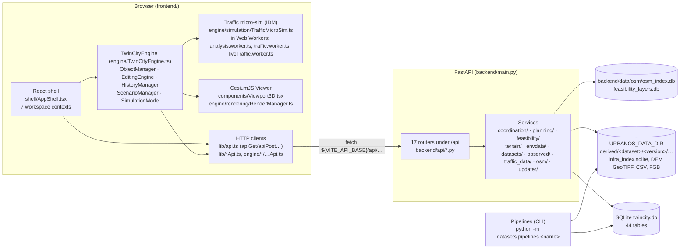

# UrbanOS — Project overview

_Audited against the code at git `8c923ac` (branch `urbanos-city-planning-redesign`), 2026-11-14 (IST). Every path, function and endpoint below was read in the source; nothing is taken from intent docs alone. Where a doc and the code disagree, the code wins and the gap is listed in §9._

> **Updated 2026-11-22 (IST) against `main` at `ba7a003`.** The UrbanOS work is now on `main`. Counts and new modules are corrected below: 17 routers / 168 endpoints, 44 tables, the data-freshness service (`backend/updater/`, official sources only), Underground screening, the curved-alignment shape editor, live traffic in a worker and Environment render-on-demand. For a practical start (running, tests, common tasks, every dataset with its endpoint) read [DEVELOPER_HANDBOOK.md](DEVELOPER_HANDBOOK.md).

Related docs: [START_HERE](START_HERE.md) · [DATABASE_AND_CODE_GUIDE](DATABASE_AND_CODE_GUIDE.md) · [DATA_CATALOGUE](DATA_CATALOGUE.md) · [CURRENT_STATUS_AND_ROADMAP](CURRENT_STATUS_AND_ROADMAP.md) · [LEARNING_GUIDE](LEARNING_GUIDE.md)

---

## 1. What UrbanOS is (in one paragraph)

UrbanOS (repo name VirtualPlanner, backend title "TwinCity Backend Service") is a **decision-support digital twin for Pune**. A planner opens a 3D map of the city (CesiumJS in the browser), draws proposed roads, flyovers, metro lines, utilities and underground alignments as *alternatives* (scenarios) on top of the existing city, checks them against terrain, underground records, environmental layers and other projects, runs an **in-browser traffic micro-simulation** to compare the alternative with the existing city, and exports audited PDF/DOCX reports. The backend is **FastAPI + SQLAlchemy on a single SQLite file** (`backend/twincity.db`) plus read-only derived GIS datasets on disk (rasters, GeoJSON, FlatGeobuf, SQLite R*Tree indexes) described by a dataset registry with provenance.

Honesty is a design rule in the code: missing data is shown as UNKNOWN (not zero), and the traffic model is labelled as **failing validation** (UK TAG M3.1) everywhere it is shown (`frontend/src/App.tsx` mounts `ModelTrustPill` in the top bar; `frontend/src/shell/contexts/SimulateContext.tsx` shows a fail banner).

| Layer | Technology (from `frontend/package.json`, `backend/requirements.txt`) |
|---|---|
| Frontend | React 19, TypeScript, Vite (+ `vite-plugin-cesium`, Tailwind 4), CesiumJS 1.143, Zustand stores, lucide icons; tests with Vitest + jsdom |
| Backend | FastAPI, Uvicorn, SQLAlchemy 2, Pydantic 2, Shapely, pyproj, numpy, pandas, rasterio, geopandas/pyogrio, Pillow, fpdf2 (PDF), python-docx (DOCX), osmium (OSM index build) |
| Database | SQLite `backend/twincity.db` (`DATABASE_URL` default `sqlite:///./twincity.db`, relative to the working directory, so start the server from `backend/`) |
| Data store | `URBANOS_DATA_DIR` → `raw/` + `derived/` trees (default `/workspace/work/urbanos-data` when present) — never committed |

---

## 2. Architecture



Startup order (`backend/main.py`): `Base.metadata.create_all` → `database.migrations.migrate` (additive ALTERs) → `planning.audit.install_triggers` (append-only SQLite triggers on `audit_log` and `planning_decisions`) → `seed.ensure_base_scenario` → `traffic_data.seed.seed_traffic_data` → `coordination.seed.seed_coordination` → `datasets.seed.seed_registry`. Then CORS (`allow_origins=["*"]`), an `x-actor` header middleware that feeds the audit log (no authentication), a gzip middleware (responses ≥ 1 KB), and 17 `include_router(..., prefix="/api")` calls. `GET /` returns a status JSON; OpenAPI docs at `/docs`.

---

## 3. The seven workspaces

Defined in `frontend/src/shell/workspaces.ts` (`WORKSPACES`, hotkeys Alt+1…7). `frontend/src/shell/AppShell.tsx` maps each id to a context-panel component (`CONTEXTS`), mounts the map (`components/Viewport3D.tsx`) once, and picks the right-hand inspector by engine mode: `SimulationPanel` (simulate) › `JunctionPanel` (build + `ljunction:` selection) › `PropertiesPanel` (build) › `InfoPanel` (view). `modeForWorkspace()` maps Design/Underground → engine mode `build`, Simulate → `simulate`, others → `view`.

| # | Workspace (title) | Context panel | Main components | Drawer tabs |
|---|---|---|---|---|
| 1 | Explore (City Explorer) | `shell/contexts/ExploreContext.tsx` | `components/explore/MunicipalLayers.tsx` + `municipalOverlay.ts`, `TerrainSection.tsx` + `terrainOverlay.ts`, `exploreModel.ts`; env overlays from `components/environment/constraintOverlay.ts`; inspector `components/InfoPanel.tsx` | — |
| 2 | Design (Infrastructure Planning) | `shell/contexts/DesignContext.tsx` | `components/design/ToolPalette.tsx` (tools from `components/tools.ts`), `ToolSettings.tsx`, `ImportAreaPanel.tsx`, `AlignmentPanel.tsx` (shape editor: PIs, radii, design speed, eMax, screening flags; engine `engine/editing/AlignmentEditor.ts` + `geometryCommit.ts`); `components/ScenarioSelector.tsx`, `ScenarioVersions.tsx`, `ScenarioDeltaTable.tsx`, `ScenarioGeneratorPanel.tsx`; inspector `PropertiesPanel.tsx` / `JunctionPanel.tsx` | — |
| 3 | Underground (Underground Planning) | `shell/contexts/UndergroundContext.tsx` (+ `.runtime.ts`, `.tabs.tsx`) | `components/underground/AlignmentForms.tsx`, `SectionViews.tsx`, `ElevationProfile.tsx`, `SubsurfaceRecords.tsx`, `SubsurfaceEvidence.tsx`, `ConflictCheck.tsx`, `ViewControls.tsx`; engine `engine/underground/*` | Profile, Cross-section, Utility table, Subsurface evidence (`UNDERGROUND_DRAWER_TABS`) |
| 4 | Environment (Environmental Intelligence) | `shell/contexts/EnvironmentContext.tsx` | `components/environment/EnvDataPanels.tsx` (`AirQualityPanel`, `RainfallPanel`, `LandcoverAreasPanel`), `EnvDataRow.tsx`, `envDataModel.ts` (`mergeCatalogue`), `envDataOverlay.ts`, `constraintOverlay.ts`, `EnvImpact.tsx` (what a proposal touches: census trees and WorldCover green area in its footprint, via `POST /api/env-data/footprint`), `EnvHoverTooltip.tsx`, `envPerf.ts` (render-on-demand), `treeTiles.ts`; `components/FeasibilityPanel.tsx` | — |
| 5 | Simulate (Simulation & Analysis) | `shell/contexts/SimulateContext.tsx` | inspector `components/SimulationPanel.tsx` → `RoadAnalysisPanel.tsx`, `TimeOfDayPanel.tsx`; `CalibrationPanel.tsx`, `OdmeAndEmissions.tsx`, `TrafficCountChecks.tsx`; HUD `SimulationHud.tsx` | Calibration, ODME, Emissions, Count checks, Through the day (`shell/contexts/SimulateDrawer.tsx`) |
| 6 | Projects (Projects & Coordination) | `shell/contexts/ProjectsContext.tsx` | tab "Projects": `components/PlanningPanel.tsx` → `components/projects/ProjectList.tsx`, `ProjectPage.tsx`, `OverviewTab.tsx`, `AlternativesTab.tsx`, `ConflictsTab.tsx`, `RecordsTabs.tsx`; tab "Data": `components/TrafficDataPanel.tsx` | — |
| 7 | Reports | `shell/contexts/ReportsContext.tsx` | project PDF/DOCX, conflict CSV, feasibility documents; `components/data/DataCatalogueSection.tsx` (opens `DataCatalogueView.tsx` overlay with tabs Datasets, Features and **Fact updates** = `FactUpdatesPane.tsx`, the data-freshness review queue) | — |

---

## 4. Folder structure (2–3 levels)

Generated folders not in the archive: `frontend/node_modules/`, `frontend/dist/`. Git-ignored but present locally: `backend/twincity.db` (`*.db`), everything under `backend/data/osm/` (`backend/data/*` rule, except tracked JSON), `frontend/.env`.

```
virtualplanner/
├── README.md                     setup (backend + frontend), env vars, checks
├── SUMO_SETUP.md                 optional SUMO install for the spike endpoint
├── .github/workflows/ci.yml      CI: frontend tsc+oxlint+vitest; backend seed.py + pytest
├── Documents/                    older planning notes (executionplan.md, phase4-benchmark.md)
├── scratch/                      ad-hoc inspection scripts (inspect_metro.py, inspect_road_props.py, search_gateways.py)
├── docs/                         engineering docs (architecture, calibration, feasibility, scenarios, validation…)
│   └── urbanos/                  UrbanOS redesign docs (UX, data, terrain, underground, environment, audits)
│       └── catalogue/            generated data-source catalogue pages (dsi.md, global.md, india.md)
├── backend/
│   ├── main.py                   FastAPI app: create tables, migrate, seed, mount 17 routers
│   ├── seed.py                   schema + mandatory "base" scenario (ensure_base_scenario)
│   ├── repair_road_sections.py   one-off repair CLI for road section properties in city_objects
│   ├── requirements.txt          Python dependencies
│   ├── twincity.db               SQLite database (git-ignored)
│   ├── api/                      HTTP routers (14 files, 17 APIRouter objects)
│   ├── database/                 connection.py (engine, SessionLocal, get_db, DATABASE_URL), migrations.py
│   ├── models/                   models.py: scenarios, city_objects, areas, scenario changes/versions/runs
│   ├── planning/                 projects, decisions, append-only audit log (audit.py), report.py (PDF/DOCX)
│   ├── coordination/             proposal elements, clearance rules, conflict detection, subsurface import
│   ├── feasibility/              site-data layers, assessments/evidence/reviews models, docgen.py (PDF/DOCX)
│   ├── terrain/                  dem.py (Copernicus GLO-30 DSM sampling), evidence.py (subsurface evidence)
│   ├── envdata/                  Environment data APIs: catalogue, raster render, vectors, trees, series
│   ├── datasets/                 dataset registry (ds_*), importer, quality, provenance check, update monitor
│   │   ├── pipelines/            reproducible download/derive CLIs (DEM, OpenCity PMC, CPCB, IMD, CHIRPS, soil…)
│   │   ├── tools/                one-off tools (DEM version compare/impact, retention blockers)
│   │   └── tests/                pipeline tests (2 test files)
│   ├── osm/                      local OSM road index (index.py, build_index.py), cached Overpass proxy (overpass.py)
│   ├── updater/                  data-freshness service: official-only allow-list (official.py), watch-list, CLI `python -m updater`
│   ├── observed/                 observed counts, screenlines, diurnal profiles, network corrections, junction matching
│   ├── traffic_data/             Traffic Data Manager: vehicle classes, PCU sets, count datasets, CSV/XLSX import
│   ├── sumo/                     optional SUMO spike (spike.py); service.py is a stub
│   ├── backups/                  JSON backup of an OSM drivability cleanup
│   ├── data/                     versioned JSON inputs + local DBs
│   │   ├── osm/                  osm_index.db, feasibility_layers.db, western-zone-latest.osm.pbf (all git-ignored)
│   │   ├── diurnal/              hourly demand profiles (pune_hourly_profile_v1.json…)
│   │   ├── network_corrections/  pune_west_v1.json
│   │   ├── observed_counts/      pune_west_2026.json
│   │   ├── observed_screenlines/ pune_cmp2008_river.json
│   │   └── observed_validation/  validation run data + analyze_validation.py
│   └── tests/                    pytest suite (36 test files) + fixtures/gov
└── frontend/
    ├── package.json, vite.config.ts, vitest.config.ts, tsconfig*.json, .env.example
    ├── public/                   favicon.svg, icons.svg
    └── src/
        ├── main.tsx, App.tsx     React entry; App renders <AppShell trust={<ModelTrustPill/>}/>
        ├── shell/                AppShell, TopBar, WorkspaceRail, CommandPalette, useShellStore, workspaces.ts
        │   └── contexts/         one context panel per workspace (+ Simulate/Underground drawers)
        ├── components/           panels and UI (PropertiesPanel, SimulationPanel, FeasibilityPanel…)
        │   ├── explore/ design/ underground/ environment/ projects/ data/   workspace-specific pieces
        │   └── ui/               design-system kit, badges (Certainty/Trust/DataStatus/ModelTrust), Drawer, Tabs…
        ├── engine/               framework-free core
        │   ├── TwinCityEngine.ts singleton engineInstance: wires objects, editing, history, scenarios, sim, viewer
        │   ├── objects/          ObjectManager (store + backend sync), types, road sections, flyovers
        │   ├── editing/          EditingEngine (draw tools), OSM import (LocalOsmIndex, OverpassClient), snapping
        │   ├── rendering/        RenderManager, ProceduralGeometryGenerator, renderers/, LOD, spatial hash, Cesium adapter
        │   ├── simulation/       TrafficMicroSim (IDM), SimulationMode, network builder, demand, signals, workers
        │   ├── calibration/ demand/ emissions/   GEH/IPF calibration, ODME, HBEFA 4 emissions
        │   ├── feasibility/      rules (investigationRules.json), siteAssessment, feasibilityApi
        │   ├── generator/        scenario generator (candidates, Pareto compare)
        │   ├── underground/      alignment geometry, terrain profile layout, UndergroundRenderer
        │   ├── scenarios/ history/ planning/ report/ terrain/ storage/ layers/ selection/ data/
        │   └── testing/          130 Vitest test files (*.test.ts) + harnesses and fixtures
        ├── hooks/                useAppMode, useKeyboardShortcuts, useSimulationMode, useCameraHeading
        ├── lib/                  HTTP clients: api.ts, infraApi, terrainApi, envDataApi, coordinationApi, datasetsApi, planning*
        └── styles/               tokens.css (design tokens); index.css at src root
```

---

## 5. How the frontend talks to the backend

* **Base URL**: `API_BASE` in `frontend/src/lib/api.ts` = `import.meta.env.VITE_API_BASE ?? 'http://localhost:8000'`. Set it in `frontend/.env` (template `frontend/.env.example`, which also holds `VITE_CESIUM_ION_TOKEN`, read by `lib/cesiumToken.ts`).
* **Generic helpers** (`lib/api.ts`): `apiGet`, `apiPost`, `apiDelete`, `apiPostBatch`, `apiDeleteBatch` (sends `POST {path}/batch/delete` with `{ids}`), all through an internal `request()` that throws `ApiError(status, endpoint, message)` and updates `connectionState` (`online | saving | offline`, shown by `components/ui/ConnectionBadge.tsx`). `ConnectionStateStore.checkConnection()` pings `GET /api/sim/status` (4 s timeout) as the health probe.
* **Typed per-area clients** that build their own `fetch(`${API_BASE}/api/<area>…`)`: `lib/infraApi.ts` (`/api/infra`), `lib/terrainApi.ts` (`/api/terrain`), `lib/envDataApi.ts` (`/api/env-data`), `lib/coordinationApi.ts` (`/api/coordination`), `lib/datasetsApi.ts` (`/api/datasets`), `engine/planning/planningApi.ts` (`/api/planning`), `engine/feasibility/feasibilityApi.ts` (`/api/feasibility`); `engine/data/trafficData.ts` and `lib/planningClient.ts` use the generic helpers.
* **Engine-level calls**: `engine/objects/ObjectManager.ts` (`/api/objects`, `/api/scenarios/{sid}/changes`), `engine/scenarios/ScenarioManager.ts` (`/api/scenarios`, `/fork`), `engine/TwinCityEngine.ts` (`/api/scenario-changes`, `/api/scenarios/{id}/versions`, `/api/scenario-versions/{vid}/restore`, `/api/runs`), `engine/editing/EditingEngine.ts` (`/api/areas`), `engine/editing/LocalOsmIndex.ts` (`/api/osm/*`), `engine/simulation/timeOfDay.ts` (`/api/diurnal-profile/{id}`), `engine/simulation/SimulationMode.ts` (`/api/network-corrections/{id}`), `engine/calibration/observedCounts.ts`, `screenlines.ts`.
* **Identity**: no login. Components read a self-declared name from `localStorage['td-user']` and pass it as `created_by` / `requested_by` / `run_by`; the backend also honours an `x-actor` header (`main.py` middleware → `planning.audit.current_actor`).
* **External (non-backend) calls**: `engine/editing/OverpassClient.ts` (OpenStreetMap Overpass API, fallback when the local OSM index is unavailable) and Cesium ion (terrain/imagery, token required).

---

## 6. Where the main capabilities live

| Capability | Where | Notes |
|---|---|---|
| GIS processing (offline, CLI) | `backend/datasets/pipelines/*.py` (`elevation.py`, `opencity_pune.py`, `infra_index.py`, `subsurface_index.py`, `tree_index.py`, `landcover.py`, `soil.py`, `surface_water.py`, `sentinel2.py`, `cpcb_air_quality.py`, `imd_rainfall.py`, `chirps.py`, `nwdp_groundwater.py`, `buildings.py`, `census2011_wards.py`), helpers `_common.py`, `_raster.py`, `_hydro.py` (own numpy D8), `kml_reader.py` | Raw originals in `raw/<source>/<date>/` + `manifest.json`; outputs in `derived/<dataset>/<version>/` + `processing.json` |
| GIS processing (online, per request) | `backend/envdata/render.py` (`render_png`, `landcover_areas`), `envdata/vectors.py`, `envdata/trees.py`, `datasets/infra_store.py` (`query`), `terrain/dem.py` (`Dem.profile`, `Dem.sample_lonlat`), `coordination/geometry.py` (UTM 43N via pyproj, Shapely STRtree) | bbox-limited, capped responses |
| Engineering analysis | `coordination/service.py` (`run_detection`, clearance rules), `terrain/evidence.py` (groundwater/soil/sewer/borehole evidence), `feasibility/` + `frontend/src/engine/feasibility/siteAssessment.ts` & `investigationPlanner.ts` (rules in `investigationRules.json`), `frontend/src/engine/simulation/BridgeFeasibilityEngine.ts`, `engine/underground/alignmentGeometry.ts` | screening grade, never "feasible" |
| Traffic simulation | **in the browser**: `engine/simulation/TrafficMicroSim.ts` (class `TrafficMicroSim`, `idmAcceleration`), orchestrated by `SimulationMode.ts` (`captureBaseline`, `runComparison`, `runJob`), run in a Web Worker by `analysisRunner.ts` → `analysis.worker.ts` → `analysisJob.ts`; network/demand rebuild in `traffic.worker.ts` (`TrafficNetworkBuilder`, `DemandMatrixCompiler`); static assignment `staticAssignment.ts`; ODME `engine/demand/odme.ts`; emissions `engine/emissions/hbefa4.ts` | backend only stores run inputs/results (`POST /api/runs`); SUMO (`backend/sumo/`) is an optional spike |
| Dataset registry + provenance | `backend/datasets/registry.py`, `models.py` (9 `ds_*` tables), `seed.py` (`seed_registry`, `sync_catalogues`), `importer.py` (scan `URBANOS_DATA_DIR`), `quality.py` (`run_checks`), `provenance_check.py` (CLI hash/commit check), `updates.py` + `update_monitor.py` (upstream change checks), `catalogue_doc.py` (generates catalogue markdown); API `api/datasets_router.py`; UI `components/data/DataCatalogueView.tsx` | |
| Scenarios / alternatives | `api/scenario_router.py`, `api/router.py`, `models/models.py`; frontend `engine/scenarios/ScenarioManager.ts`, `ObjectManager.ts` (baseline ⊕ proposal overlay) | proposals store *changes* to base objects, never edit base rows |
| Projects, decisions, audit | `api/planning_router.py`, `planning/models.py`, `planning/audit.py` | audit via SQLAlchemy session hooks + SQLite triggers |
| Reports | `planning/report.py` (`build_model`, `render`) and `feasibility/docgen.py` (`render_pdf` via fpdf2, `render_docx` via python-docx) | |

---

## 7. One real workflow per workspace (UI → client → HTTP → router → service → storage → response → render)

### 7.1 Explore — show a municipal infrastructure layer (e.g. PMC sewer lines)
1. **UI**: `components/explore/MunicipalLayers.tsx` → `MunicipalLayerGroups` loads the catalogue with `useInfraCatalogue()` → `infraApi.catalogue()` (`GET /api/infra/layers`). Clicking a `LayerRow` calls `setMuniLayerVisible(layer, true)` in `components/explore/municipalOverlay.ts`.
2. **Client**: `municipalOverlay.ts` `load(id)` → `infraApi.features(id, bbox)` (`lib/infraApi.ts`), bbox = current camera view; reloads when the camera stops.
3. **HTTP**: `GET /api/infra/layers/{lid}/features?bbox=minLon,minLat,maxLon,maxLat[&limit=]`.
4. **Router**: `backend/api/infra_router.py` `infra_features()` — validates bbox, refuses dense layers over `MAX_BBOX_DEG2` (`too_large: true`).
5. **Service**: `backend/datasets/infra_store.py` `query(lid, bbox, limit, where)` — R*Tree bbox (`r_<lid>`) then exact Shapely intersection on `f_<lid>` WKB.
6. **Storage**: `<URBANOS_DATA_DIR>/derived/infra_index/<latest version>/infra_index.sqlite` (built by `python -m datasets.pipelines.infra_index`; override `URBANOS_INFRA_INDEX`). Locally: `derived/infra_index/v1`.
7. **Response**: GeoJSON `FeatureCollection` + `layer, bbox, total_in_bbox, returned, not_shown, truncated, cap, meta` (layer provenance: publisher, licence, sha256, data_class, suitability), `message` when capped.
8. **Render**: `drawGeometry()` adds Cesium entities (points/polylines/polygons) into a `CustomDataSource` with ids `muni:<layer>:<fid>`; a status line shows "N shown / M not shown"; clicking a feature fills `MunicipalInspector`.

### 7.2 Design — draw a new road in an alternative
1. **UI**: `components/design/ToolPalette.tsx` → `choose('draw_road')` → `engineInstance.editing.setMode('draw_road')` (tool list in `components/tools.ts`).
2. **Engine**: clicks collect points; `EditingEngine.finalizeDrawing(scenarioId)` (`engine/editing/EditingEngine.ts`) builds a `road` object (class-based width, lanes, speed, capacity), records undo via `HistoryManager.recordAdd`, and calls `ObjectManager.add(obj)` (`engine/objects/ObjectManager.ts`), which runs `syncRoadProperties` and `syncPost(obj)` through a per-object write queue.
3. **HTTP**: `POST /api/objects` (body `CityObjectSchema`: id, type, name, layerId, scenarioId, coordinates, properties). Editing a *baseline* object inside a proposal instead goes to `POST /api/scenarios/{sid}/changes` (`ObjectManager.syncChanges`).
4. **Router**: `backend/api/router.py` `save_object()` (upsert; `_refuse_base_move` protects base rows) / `backend/api/scenario_router.py` `write_changes()`.
5. **Storage**: table `city_objects` (`CityObjectEntity`, geometry and properties as JSON text) / `scenario_object_changes` (`ScenarioObjectChangeEntity`, op `modify|delete`, `seq`).
6. **Response**: `{"status":"success","message":"Object saved successfully"}`; failures flip `connectionState` and show a toast.
7. **Render**: `ObjectManager.notify()` → `TwinCityEngine` `objects.onChange` → `renderManagerInstance.reconcile(getFilteredObjects())` → `engine/rendering/geometry/ProceduralGeometryGenerator.ts` meshes. Saving a named version: `components/ScenarioVersions.tsx` → `engineInstance.saveScenarioVersion()` → `POST /api/scenarios/{sid}/versions` → `scenario_router.save_version()` → `scenario_versions` + `scenario_version_changes`.

### 7.3 Underground — ground profile under a drawn alignment
1. **UI**: drawer tab "Profile" (`shell/contexts/UndergroundContext.tabs.tsx`) → `ProfileView` in `components/underground/SectionViews.tsx` takes the active alignment (`useActiveAlignment`).
2. **Client**: `useTerrainProfile(coords)` in `components/underground/useTerrain.ts` (cached) → `terrainApi.profile(coords, 30)` (`lib/terrainApi.ts`); in parallel `useSubsurfaceEvidence` → `terrainApi.evidence`.
3. **HTTP**: `POST /api/terrain/profile` `{coordinates, step_m}` (and `POST /api/terrain/subsurface-evidence`).
4. **Router**: `backend/api/terrain_router.py` `profile()` → `_dem()` → `terrain.dem.get_dem()`; metadata via `registry_version(db, "elevation_copdem30", version)`.
5. **Service**: `terrain/dem.py` class `Dem.profile()` — samples bilinear DSM every `step_m` in UTM; evidence via `terrain/evidence.py` `evidence()` (`groundwater`, `soil`, `sewers`, `boreholes`).
6. **Storage**: GeoTIFF `derived/elevation_copdem30/<version>/dem_copglo30_epsg32643_30m.tif` (default version `v3`, override `URBANOS_DEM_VERSION`); registry row in `ds_dataset_versions`; evidence reads `nwdp_groundwater_pune`, `soil_soilgrids250`, `pmc_sewage_pipelines_fgb` derived files and `subsurface_records` (boreholes).
7. **Response**: `{samples:[{chainage_m, lon, lat, elevation_m, status}], step_m, length_m_utm, vertex_chainage_m_utm, summary:{n, n_ok, min_m, max_m, coverage_fraction…}, dataset:{… accuracy, DSM warning}}`.
8. **Render**: `ElevationProfileSvg` (`components/underground/ElevationProfile.tsx`, layout `engine/underground/terrainProfile.ts` `layoutElevationProfile`) draws an SVG with the DSM ground line, the alignment crown/invert, cover warnings and PMC sewer crossings; falls back to `ProfileSvg` (flat ground) when no samples. The context panel's subsurface list uses `useSubsurfaceRecords()` → `coordinationApi.listDatasets/listRecords` → `GET /api/coordination/subsurface/datasets|records` → tables `subsurface_datasets`, `subsurface_records`, drawn by `engine/underground/UndergroundRenderer.ts`.

### 7.4 Environment — measured air quality at a CPCB station
1. **UI**: `shell/contexts/EnvironmentContext.tsx` shows the "Air quality — measured at stations" disclosure when the env catalogue has `air_cpcb_caaqms` (`envDataApi.catalogue()` → `GET /api/env-data/catalogue`, merged with `coordinationApi` environment layers by `mergeCatalogue`). It mounts `AirQualityPanel` (`components/environment/EnvDataPanels.tsx`).
2. **Client**: `envDataApi.airStations()` then `envDataApi.airSeries(station, param, agg)` (`lib/envDataApi.ts`).
3. **HTTP**: `GET /api/env-data/air/stations`, `GET /api/env-data/air/series?station=…&param=pm25_ugm3&agg=day|month`.
4. **Router**: `backend/api/envdata_router.py` `air_series()` (checks the layer via `_layer("air_cpcb_caaqms")`).
5. **Service**: `backend/envdata/series.py` `aq_series()` — pandas resample of 15-min values (mean, max, n), no gap filling.
6. **Storage**: `derived/cpcb_caaqms_pune/2026-11-13/aq_15min_pune.csv` and `stations_pune.geojson` (paths via `envdata/paths.py` `derived()`).
7. **Response**: `{station_id, parameter, label, unit, agg, samples_per_full_bucket, first, last, points:[{t, v, max, n}], data_class:"observed", note}`.
8. **Render**: `LineChart` (local to `EnvDataPanels.tsx`) plus a caption counting partial days; an empty series says "UNKNOWN, not zero". Map overlays of rasters use `GET /api/env-data/layers/{lid}/render.png` (`envdata/render.py`), and constraint overlays (water/heritage/railway) use `GET /api/feasibility/site-data` (`feasibility/layers.py` on `backend/data/osm/feasibility_layers.db`).

### 7.5 Simulate — compare a proposal with the existing city
1. **UI**: in Simulate, click a road; inspector `components/SimulationPanel.tsx` → `components/RoadAnalysisPanel.tsx` buttons "Save existing city" → `mode.captureBaseline()` and "Compare" → `mode.runComparison()` (`mode` = `engineInstance.simMode`, class `SimulationMode`).
2. **Engine**: `SimulationMode.runJob()` → `startAnalysisJob()` (`engine/simulation/analysisRunner.ts`) spawns `analysis.worker.ts` → `runAnalysisJob()` (`analysisJob.ts`) → `new TrafficMicroSim(...)` with IDM car-following (`idmAcceleration`), seeded demand trips, signal timing. Inputs fetched once: `GET /api/diurnal-profile/{id}` (`timeOfDay.ts` → `observed_router.get_diurnal_profile` → `backend/data/diurnal/*.json`), `GET /api/network-corrections/{id}` (→ `backend/data/network_corrections/pune_west_v1.json`), optional counts `GET /api/traffic-data/counts`, `GET /api/observed-counts/{id}`.
3. **HTTP (recording)**: `SimulationMode.recordRun()` → `runRecorder` set in `TwinCityEngine.ts` → `POST /api/runs` `{scenarioId, inputs, results}`.
4. **Router**: `backend/api/scenario_router.py` `record_run()` — computes `change_set_hash(head_change_set(...))` and `baseline_fingerprint(db)`.
5. **Storage**: table `scenario_runs` (`ScenarioRunEntity`; inputs/results as canonical JSON).
6. **Response**: run dict with `id`; stored as `snap.runId` so stale checks (`GET /api/coordination/stale/run/{id}`) can later tell if the scenario changed.
7. **Render**: results (delay, LOS, travel time deltas) shown in `RoadAnalysisPanel` / `RoadAnalysisPieces.tsx`, vehicles drawn by `engine/rendering/renderers/MicroTrafficVisualizer.ts`; drawer tabs show calibration (GEH), ODME and HBEFA emissions. The fail banner in `SimulateContext.tsx` is static text.

### 7.6 Projects — create a planning project, then run conflict detection
1. **UI**: Projects tab → `components/PlanningPanel.tsx` "New project" form → `planningApi.create({name, description, area_id, created_by})`.
2. **Client**: `engine/planning/planningApi.ts` `call('POST', '/projects', …)`.
3. **HTTP**: `POST /api/planning/projects`.
4. **Router**: `backend/api/planning_router.py` `create_project()` — validates area/bbox, sets `baseline_fingerprint(db, "base")`, status `draft`, id `prj_<12 hex>`.
5. **Storage**: `planning_projects` (`PlanningProjectEntity`); `planning/audit.py` session hooks write a `create` row to `audit_log`.
6. **Response**: `_project_out(full=True)`: id, name, bbox, status/status_label, baseline fingerprints + `baseline_changed_since_created`, `links`, `decisions`, `area`.
7. **Render**: `ProjectList.tsx` / `ProjectPage.tsx` (tabs Overview, Alternatives, Assessments, Datasets, Conflicts, Reviews & decisions, Activity — the last tabs live in `RecordsTabs.tsx`). Conflicts: `ConflictsTab.tsx` → `coordinationApi.detect` → `POST /api/coordination/projects/{pid}/detect` → `coordination_router.detect()` → `coordination/service.py` `run_detection()` (elements vs other projects, baseline roads, OSM metro, utilities, buildings; `clearance_rules`) → tables `coordination_runs`, `coordination_conflicts`.

### 7.7 Reports — export a project PDF
1. **UI**: `shell/contexts/ReportsContext.tsx` lists projects (`planningApi.projects()`) with scope (`planningApi.project`, `planningApi.audit`, `coordinationApi.projectStale`); the "PDF" link's `href` is `planningApi.reportUrl(id, 'pdf', who())`.
2. **HTTP**: `GET /api/planning/projects/{pid}/report?format=pdf|docx&requested_by=…` (plain browser download).
3. **Router**: `planning_router.export_report()`.
4. **Service**: `planning/report.py` `build_model(db, project)` (reads `planning_projects`, links, `planning_decisions`, `scenarios`, `scenario_versions`, `scenario_runs`, `fs_*`, `td_*`, `areas`) → `render()` → `feasibility/docgen.py` `render_pdf` (fpdf2; font via `TWINCITY_PDF_FONT_DIR`) or `render_docx`.
5. **Storage**: writes an `export` row to `audit_log` with `after_hash=sha256:<file hash>`; the file itself is not stored.
6. **Response**: binary attachment `planning-report-<name>.pdf`, header `X-Report-SHA256`.
7. **Render**: browser downloads; after 1.5 s `refreshSoon()` re-reads the audit and `lib/planningReports.ts` `lastExport()` shows "last generated". Feasibility documents: `generateDocument` → `POST /api/feasibility/assessments/{aid}/documents` → `feasibility_router.generate_document` → `fs_documents` + file under `TWINCITY_FEAS_FILES`; download `GET /api/feasibility/documents/{did}/download`.

---

## 8. Running it (from README.md, verified against code)

```bash
cd backend && pip install -r requirements.txt && uvicorn main:app --reload --port 8000
cd frontend && cp .env.example .env && npm install && npm run dev   # http://localhost:5173
```
Tests: `npm test` (Vitest, only `src/engine/testing/**/*.test.ts`), `python -m pytest tests` in `backend/` (also `datasets/tests`). Pipelines: `python -m datasets.pipelines.<name>` from `backend/`.

---

## 9. Gaps between docs and code found in this audit

* `docs/urbanos/URBANOS_OVERVIEW.md` §3 (2026-11-13) still lists "an offline DEM", "PMC storm-water and utility records" and Rasterio as missing/later — the code now ships `terrain/dem.py` (Copernicus GLO-30 v3), rasterio in `requirements.txt`, and the DB holds 44,482 PMC sewer + 9,187 storm-drain QL-D records (`subsurface_datasets`).
* `backend/sumo/service.py` `SumoService` is a "Phase 5 stub" (all methods raise `NotImplementedError`); only `POST /api/sim/spike` (`sumo/spike.py`) works, and only when `SUMO_HOME` is set.
* `frontend/src/engine/report/scenarioReport.ts` is not imported by any production file (ReportsContext says so).
* `frontend/src/lib/api.ts` says "ALL fetch calls … must go through this module". On 2026-11-14, 12 other files called `fetch()` directly; on 2026-11-22 only `engine/editing/OverpassClient.ts` does (the public-Overpass fallback when the backend is offline); the API clients now go through `trackedFetch`, which marks the header Offline when the server cannot be reached.
* More in [CURRENT_STATUS_AND_ROADMAP](CURRENT_STATUS_AND_ROADMAP.md) and §8 of [DATABASE_AND_CODE_GUIDE](DATABASE_AND_CODE_GUIDE.md).
